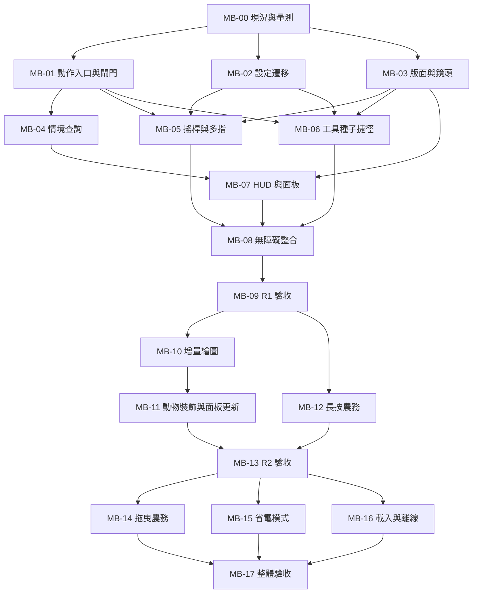

# 手機體驗修改計劃

日期：2026-10-22｜版本：1.1｜狀態：使用者已採用，任務執行中。

本計劃以 [game3 研究報告](https://chatgpt.com/c/6ad9e53f-6744-83ee-819b-8f8b17882c79)「Dewhollow Farm 行動端體驗最佳化深度研究與實作計畫」及本機工作樹交叉核對後整理。執行入口為 [MOBILE_TASKS.md](MOBILE_TASKS.md)。後續 agent 可只讀這兩份文件與任務指定來源，不需重讀聊天紀錄。

## 1. 結論與範圍

**適合**：沿用 TypeScript、Phaser、DOM UI、IndexedDB/PWA 與現有分層，依序改善輸入、版面、工具／種子捷徑、面板與已量測的繪圖成本。現有觸控已能完成遊戲循環，這次目標是降低操作負擔並提升可讀性，而非更換引擎。

**有條件適合**：浮動搖桿、覆蓋式控制、長按連續農務、拖曳農務、畫質模式、延後載入。分別需要確認格子移動語意、遮擋範圍、成本與中斷、距離限制、釣魚計時及完整離線行為。

**本次不採用**：自由移動重寫、雲端存檔、多人系統、新 UI framework、原生 App 包裝、第三方追蹤 SDK。報告提及的 gamepad、Capacitor、進階背包／裝飾拖放、震動與字幕等，列為後續獨立提案，不混入手機操作首版。

使用者已明確採用本計劃，授權依任務表實作、完整測試、逐項提交 PR 並合併至 `main`。部署仍需另外授權；若遠端規則或必需檢查狀態不可觀測，依發布診斷停止該候選並回報穩定原因碼。

## 2. 可信基準與報告修正

核對基準：Git HEAD `3d11eb41a0a1a357b22da932cb242237cff751b0` **加上當時未提交工作樹**，不是單純遠端 main。後續開始實作前必須重新檢查差異；以下是靜態證據，不是本次實機測量結果。

| 項目 | 本機證據 | 對計劃的影響 |
| --- | --- | --- |
| 技術版本 | `package.json`：Phaser `^4.2.1`、Dexie `^4.4.6`、Zod `^4.6.7` | 報告的套件數字部分已不同；不為 UX 改版升級依賴，安裝版本以 lockfile 為準 |
| 格子移動 | `game-commands.ts` 的 `move(direction)`、碰撞與進門；`MapScene.movePlayer()` 插值動畫 | 搖桿先量化為四方向，不直接引入連續世界座標或斜走 |
| 情境互動 | `interact()` 已處理 NPC、作物、門周邊設備、釣魚、床、出貨、裝飾等 | 新增共用的唯讀互動描述，不能在 HUD 複製另一套規則；門實際由移動進入 |
| 工具／種子 | 已有 `takeTool`；`cycleSeed` 以 `index.cropIds()` 循環，未見直接選種子指令 | 工具沿用現有指令；種子新增明確驗證過的直接選取指令，不靠多次 cycle |
| 輸入 | `touch-pad.ts`、`touch-controls.ts`、`MapScene.handleKey()`：ActionId → key → action，移動共用單一 interval | 先抽共用動作入口、輸入閘門及 pointer 生命週期，再加入多指與搖桿 |
| 設定 | `Settings` 本體不含版本；`LocalSettingsStore` 序列化時加版本；不符 v1 時回預設 | 維持 envelope 所有權；先做保留既有欄位的 v1→v2 遷移，不照抄報告 interface |
| 存檔 | `SAVE_SCHEMA_VERSION = 23`；`SAVE_SLOTS` 有三槽；歷史 migration 與匯出入已存在 | UI 改版不升 GameState schema；README 的單槽說明已落後，交接時要修正 |
| 版面／測試 | `camera.ts`、CSS、`touch.spec.ts` 已覆蓋直橫式，舊測試明確要求控制區不覆蓋 canvas | 保留外置控制模式；新增 overlay 模式時改驗收為「關鍵可見區不被遮擋」，不能直接刪掉舊測試 |
| 效能基礎 | 未提交的 `frame-stats.ts`、`perf-overlay.ts`、`DEVICE_PERF.md`、相應測試 | 先驗證並沿用，避免重做；目前顯示約五秒視窗，不能把最後一筆當成整段 30 秒統計 |
| 繪圖候選 | `refresh()` 呼叫 plots／animals／decor 同步；三者存在銷毀重建；world tiles 已先比較 texture | 需要量測分配量、更新次數和主執行緒成本；不是已證實的手機瓶頸 |
| 現有修改 | main、character-rig、placeholder-resident、MapScene、styles，以及居民路徑／效能／農務模型測試等未提交 | 保留所有既有修改；新任務不清理 `.claude/skills` 或 `.claude/worktrees` |

`docs/DEVICE_PERF.md` 的桌機觀察只適用當時情境，不足以排除手機遊戲邏輯瓶頸；「兩分鐘必然降頻」等固定敘述也應改為依裝置觀察。量測文件的首次載入傳輸量不能取代 `npm run budget` 的原始 bytes 預算。

## 3. 分期與相依關係

| 發布批次 | 玩家可得到的成果 | 任務 | 可停在此版嗎 |
| --- | --- | --- | --- |
| R1 手機核心版 | 穩定多指輸入、直橫式切換、搖桿／D-pad、工具種子直接選取、可閱讀面板 | MB-00～MB-09 | 可以；這是優先交付範圍 |
| R2 流暢與省操作版 | 根據量測改善繪圖、可關閉的長按連續工作與真機回歸 | MB-10～MB-13 | 可以；不依賴拖曳農務 |
| R3 進階操作版 | 有距離限制的拖曳農務、可選省電、必要時的載入改善與整體收尾 | MB-14～MB-17 | 條件式項目可附理由延後 |

箭頭是工程相依。執行時一項任務對應一個可審查差異；互不重疊的變更邊界可在獨立 worktree 並行，碰到相同邊界則一次只留一個寫入者，依賴項等前置任務合併後再啟動。MB-10／11 若真機已嚴重不達標，可在 MB-00 證據齊全後提前；不可先做無量測的大型 renderer 重寫。

## 4. 操作與畫面契約

### SCR-01 世界畫面與輸入

- 統一輸入語意為移動意圖、停止、主要動作、選工具、選種子、開選單與取消。DOM／鍵盤 adapter 留在 presentation；application 不接收 PointerEvent 或 Phaser 物件。
- 輸入閘門涵蓋改鍵、模態面板、心形事件、釣魚／星釣計時、動作中、換圖及停止。沿用現有優先序；新路徑不能繞過 `handleKey()` 現有保護。
- 每個 pointerId 擁有自己的 gesture 與 capture；左指移動、右指動作可同時運作。右指放開不得清掉左指狀態。
- pointerup、pointercancel、lostpointercapture、blur、visibility hidden、scene shutdown 均釋放對應輸入與計時器。進入面板、換圖與旋轉時停止移動及未完成農務；恢復後須重新按下，避免補發。
- 搖桿初版保留四方向一格一格走，移動頻率與既有規則相同。向量以主軸量化，軸切換加遲滯；dead zone／半徑／長按閾值集中為可調 UX 常數，不按 pointermove 次數移動。
- 建議預設浮動搖桿；可選固定搖桿、D-pad、慣用手與外置控制區。先以試玩結果調校預設，不宣稱使用者已偏好浮動搖桿。

### SCR-02 快捷工具與種子

- 核心需求是「直接選」，不是輪盤造型。先有點開、點選的列表或格狀選單，接著補上同資料來源的長按滑選輪盤；鍵盤與輔助操作仍可直接選。
- 短點可切回上次有效工具／種子；長按開輪盤。短點於放開判定，長按成立後不得再送短點；統一一個 hold 閾值，消除報告 220～280 ms 的未定義區間。
- 建議 hold 初值 280 ms，工具圈 6～8 格；超出改分頁／列表。輪盤在 safe viewport 內移位，不縮到無法點選；手指偏離取消區、pointercancel 或中心區放開不選取。
- 種子選單來自持有數量 > 0 的種子，依固定穩定排序呈現，開啟期間不因數量變動跳位；顯示名稱、數量與不可種原因。零種子顯示空狀態。非當季種子不應簡單隱藏，須考慮溫室規則。
- application 驗證直接選取：已知工具／種子、有效 ID、庫存；種植合法性仍由既有農務規則判斷。選種子應原子地進入正確播種工具狀態，避免選了種子卻仍拿水壺。
- 實際選中項目仍使用現有 GameState 欄位；上次使用、我的最愛屬設定或暫存，載入存檔後重驗，不新增 save 欄位。
- 旋轉保留已選工具／種子、輪盤種類與開啟狀態，重新排版並清除舊 hover／capture；旋轉後只能以新的手勢確認，不能依舊螢幕座標誤選。

### SCR-03 情境動作

- application 提供唯讀 `InteractionDescriptor`，含目標、動作種類、標籤 key、可用性與原因。HUD 只把 key 轉成 `content/` 原創文字；查詢不可消耗體力、時間、亂數或改狀態。
- 抽取 `interact()` 已有的目標／優先序判定供查詢與執行共用。送出時仍由既有 command 重新驗證，不信任過期 HUD；不可 HUD 顯示收成，實際卻收回裝飾。
- 主要按鈕顯示對話、收成、澆水、播種、工作台等實際動作。門顯示「走入」導引，保留目前踏入格子換圖行為；若要改成按鈕進門，另列規則變更。
- 釣魚／星釣進行中主要按鈕轉為既有收線／收網路徑；不得被連續農務重複觸發。床、出貨、商店、劇情及裝飾收回不列入自動連續動作。

### SCR-04 直橫式版面

- 單一 `ViewportMetrics` 包含容器尺寸、visual viewport 可見範圍與 offset、安全區、pointer 能力、使用者控制偏好；`LayoutManager` 輸出版型、world rect、可安全顯示角色／目標的 rect、控制區與 CSS tokens。
- `ResizeObserver`、視窗／VisualViewport resize 等變化每動畫幀合併處理；不能同時以 CSS、camera.ts 與 JS 三組不一致斷點作決策。保留現有 `layout.ts` 的座標函式，避免同名新模組覆蓋它。
- VisualViewport 與 layout viewport 用途不同，軟鍵盤和縮放可能只改前者；需支援 fallback，不因輸入法誤判橫式。參考 [MDN VisualViewport](https://developer.mozilla.org/en-US/docs/Web/API/VisualViewport)。
- 直式：頂端精簡時間／天氣／體力／金錢，中間世界、底部快捷與雙手控制。橫式：世界延展、控制區可半透明覆蓋邊角，角色、目標、提示與必要任務狀態留在安全可見區。
- 手機旋轉只改 composition、camera bounds/zoom/deadzone 與 controls；不 reload、restart scene、重載資產或改角色位置。對話開啟狀態、輸入內容、焦點 key、捲動錨點保留。
- 不強制瀏覽器鎖定方向、不要求全螢幕；375×812 等現有尺寸與新矩陣都要可用。粗指標只是能力訊號，混合輸入裝置與手動 touch on/off 也必須正確。

### SCR-05 HUD、文字與面板

- 世界 HUD 僅保留高頻資訊，任務可收合；完整居民、收藏、技能、任務等留在管理面板。工具、種子與主要動作保持可見。
- 直式面板採底部或近全螢幕 sheet；低高度橫式採側邊／全螢幕；桌機保留 centered dialog。先共用外框，再搬內容；沿用 `panel-dialog.ts` 的焦點循環／還原，不能每旋轉重建整份面板。
- 文字沿用既有 fontScale，避免再乘一次 viewport scale；100%／125%／150% 與長文字都不可遮住關閉、確認。正文行寬約 18～22 個全形字為設計參考，不作硬性截斷。
- 專案建議核心觸控目標至少 48 CSS px、主要動作 64～72 px；空間不足改排版或捲動，不縮字塞入。這是本專案設計目標，不宣稱為平台規範。
- 色彩之外保留圖示／文字；提供減少動態、顯示音效提示及可關閉震動的擴充點。非必要的新震動、字幕或對話自動前進另案設計。

### SCR-06 連續與拖曳農務

- R2 先做長按目前面前有效田地的澆水、耕地、播種；開關預設關閉。每次經原 command，照既有體力、時間、種子與成長規則結算，失敗立即停止，避免訊息洗版。
- 禁止自動切到收成、睡覺、出貨、送禮、砍樹或釣魚。移動導致目標改變時重新查詢；單次手勢對同格同動作最多成功一次。
- action runner 只能有一個執行中命令，依命中與動畫完成推進，不設另一個與遊戲動畫競爭的 interval；動作鎖不阻止讀取 UI 或取消。
- R3 拖曳先以明確農務模式開啟；預覽候選格與有效／無效原因，**僅接受當下角色可觸及的相鄰目標**。不預設自動尋路、遠距播種或整片瞬間結算。
- 若未來希望跨整片田拖曳後自動走路，必須另規劃玩家尋路、移動障礙、目標順序、時間成本與中斷；不能直接重用居民視覺尋路當遊戲規則。
- 跨圖、入背景、開面板、旋轉、選工具／種子、資源耗盡或取消時清空未執行隊列。已完成的命令不倒帶，未執行的不扣款；pointer、path、queue 不入存檔。

## 5. 架構與相容性

| 層 | 建議責任與變更 | 不可放入 |
| --- | --- | --- |
| domain | 沿用格子、體力、農務規則；settings v1→v2 的純資料驗證 | DOM、Phaser、儲存 API、手勢計時器 |
| application | 直接選種子、共用互動查詢、command 結果與必要的序列協調 | pointerId、畫布座標、輪盤開關 |
| infrastructure | 設定 envelope 的版本讀寫、現有 IndexedDB 與資產載入 | UI 排版或手勢判斷 |
| presentation | input adapter／controller、layout manager、快捷選單、sheet、dirty renderers、動畫協調 | 複製農務合法性或自行扣體力 |
| main.ts | 具體實作的組裝、設定與 session 注入 | 新增另一個隱含組裝入口 |

建議新模組：`presentation/input/`、`presentation/responsive/`、`presentation/render/`。只在任務需要時建立，避免先搭空架構。可測試的 pure function 與薄 DOM/Phaser adapter 分開。

採 Extract Method／Extract Class 與 Parallel Change：先保留相容入口，將鍵盤與 touch 接到同一個動作路徑，再移除舊 key 往返。行為保持的拆分和新增功能分開提交；不按檔案長度強制拆檔。

局部靜態盤點的結構評估暫為 **5/10（低信心，非全專案評分）**：MapScene 多職責、handleKey 長方法、touch key 往返是主要因素；未經完整診斷的項目不算已通過。改善方向是共用 action gateway、抽輸入／render 責任、刪除重複分支並以行為回歸驗證；不把「10/10」當發布條件。

### 設定與存檔

- MB-02 在任何新偏好落盤前完成。v1 保留 bindings、fontSize、colorblind、effects、touchControls；v2 新增 controlStyle、handedness、buttonScale、controlsPlacement、continuousActions，quality 到 MB-15 才啟用。
- 維持 storage envelope 的 schemaVersion；欄位壞掉逐欄 fallback。未來未知版本先不覆寫原資料，使用安全的本次預設並顯示可理解訊息；儲存失敗沿用「本次生效但未保存」語意。
- 巢狀 mobile patch 要合併保留兄弟欄位，不能沿用目前 top-level shallow merge 而洗掉其他手機偏好。備份只在測試 fixture 或使用者明確要求時建立，不暗存原始個人資料。
- 偏好、方向、pointer、輪盤、queue、面板幾何不得加進 GameState；v23 存檔與所有舊 fixture 要能載入。選擇的工具／種子沿用原欄位。

### 繪圖與效能

- MB-10 優先比較 command 前後的必要欄位／集合與 stable key，形成 presentation DirtySet；先不擴大公開 `CommandOutcome`／事件契約。
- plot 以 map+coordinate 對應可重用物件；尊重 `heldPlots` 命中前舊圖、收成動畫、減少動態；跨圖、睡覺、換季、載入存檔有明確 full refresh。
- animals／decor 使用現有 ID 或 map+slot／item+coordinate 穩定鍵差分更新；鍵選擇前核對資料模型，不為畫圖新增持久 ID。居民與夥伴路線、衣物、season tint 不因未 dirty 而漏更新。
- HUD／panel 更新依資料變更與可見性決定；關閉面板可延後 refresh，開啟時一定讀最新狀態；不依 state object identity 判斷所有子資料都變。
- 省電只改呈現，不改 command 次序、遊戲時間與釣魚判定。若目前 update loop 與計時耦合，先拆開再考慮 30 FPS；不能以偽造時間補償方式「通過」測試。
- 延後載入只在 cold/warm 基準顯示值得時進行；離線承諾必須同步調整安裝就緒判定。未快取的地圖不能宣稱可完整離線，舊 worker 與新資產亦不可混版。

## 6. 驗收與量測

所有數字皆為目標或既有規範；本次未宣稱已達成。MB-00 建立可重現 fixture、路徑、瀏覽器與裝置版本後，才把新建議門檻升格為發布必要條件。

| ID | 必要驗收／建議目標 | 方法與證據 |
| --- | --- | --- |
| AC-01 | 相同輸入序列的格子、碰撞、時間、體力、物品結果與原規則一致 | application/domain 測試與完整農務 E2E |
| AC-02 | 左移動＋右動作可並行；所有取消／生命週期事件後無 stuck movement／殘留 queue | pure state machine＋DOM 合成事件測試；實機雙指必驗 |
| AC-03 | 直橫互轉十次，世界不重建；角色、背包、日期、選取、面板及焦點不遺失 | resize E2E 比較前後狀態；Safari/Android 實測 |
| AC-04 | 任意可用工具／種子可透過開啟＋選取兩次點擊完成；無長按替代路徑可用 | 指定至少三種種子的 fixture；UI 與 command 測試 |
| AC-05 | 固定「澆水→指定種子→播種」等價流程比 MB-00 減少 ≥30% 點擊，50% 為延伸目標 | 同 fixture、同起點、同任務與終態；記錄 taps、總手勢、耗時，長按不直接算零成本 |
| AC-06 | 核心觸控 ≥48 CSS px；字級 100/125/150% 無內容遮擋，關閉／確認可見 | bounding box、overflow、focus E2E＋真機可讀性 |
| AC-07 | 既有中階手機每情境 FPS ≥50；建議進階目標中階中位 ≥55、低階 ≥45、60Hz 模式 p95 <25ms、>50ms frame <1% | 每次 10s 暖機＋30s 完整 active-window 幀樣本，三次取情境統計中位；不同裝置／更新率分開，不用五秒尾讀數代表全程 |
| AC-08 | 建議旋轉穩定 <250ms，輪盤開啟 <100ms | 從 viewport 事件／長按辨識完成到下一個穩定可互動畫面；輪盤數字不包含 280ms hold 等待；報 p50/p95 |
| AC-09 | 既有首次載入原始檔案預算 ≤8MB；建議 cold <4s、warm <2s | `npm run budget` 與網路傳輸量分列；明定網路條件、空／暖 cache、排除 dev server |
| AC-10 | 三槽、匯出入、v1 至目前歷史 fixture、設定 v1→v2 皆正確；未知設定版本不被靜默改寫 | migration、storage refusal、save-slots E2E；不能只測 fresh profile |
| AC-11 | 完整安裝後離線可進入約定所有區域、讀寫存檔；更新等待不覆蓋未存進度 | 正式 build 的 preview／HTTPS、斷網／更新／混版失敗情境 |
| AC-12 | 前景 30 分鐘農務／面板／換圖循環無持續物件洩漏；背景停止自訂輸入與昂貴動畫 | 可用時記 heap 趨勢與回落；Safari 無 heap API 時記物件／listener／timer 計數、原生 profiler／重載異常，不填假值 |
| AC-13 | 桌機鍵盤、改鍵、釣魚、心形事件、居民路徑、跟隨、動畫、render compatibility 回歸通過 | `npm run check`、`npm run test:e2e`；規則／成本變動再跑 sim |
| AC-14 | 同 seed、同 command 序列在各畫質模式的遊戲終態一致 | deterministic command 測試＋實機畫面節奏確認 |

測試能力分開：Playwright 可模擬 viewport、hasTouch、device 參數；不能因此宣稱真機 GPU、散熱或 OS 手勢已測過。參考 [Playwright Emulation](https://playwright.dev/docs/emulation)。Pointer capture、pointercancel 與 touch-action 邊界採原生事件機制，參考 [MDN Pointer events](https://developer.mozilla.org/en-US/docs/Web/API/Pointer_events)。

### 最小矩陣

- 自動化版面：360×800、375×812、390×844、412×915、812×375、844×390、915×412、768×1024、1024×768、1280×720；覆蓋粗／細指標、touch on/off、大字、左右手、外置／overlay。
- 避免所有組合笛卡兒乘積：每次 PR 跑核心直／橫＋桌機 smoke；版面任務跑全部尺寸；R1/R2/最終候選跑完整相關回歸。
- 實機必要：一台小／瀏海 iPhone Safari、一台中階 Android Chrome，直／橫與 PWA standalone；低階 Android 為擴充支援門檻，尚未取得裝置時標「未驗證」，不可宣稱支援已通過。
- 每筆記錄含候選 commit／工作樹識別、fixture、裝置與 OS/browser、viewport/DPR/Hz、天氣、電源與散熱狀態、快取、網路、步驟、三次統計及限制。不要預設低電量或充電狀態等價。
- 人工試玩建議至少三位，完成移動、換種子、連續農務、旋轉與開面板；記錄任務成功、誤觸與完成時間。樣本只作設計回饋，不宣稱市場偏好；不收身分資料、不錄影，除非另行同意。

## 7. 風險、決策與發布邊界

| 風險 | 處理方式 |
| --- | --- |
| 新舊輸入都觸發 | 共用 gateway，每個 DOM 事件只有一個意圖；長按 suppress click；排除鍵盤 auto-repeat 的雙重排程 |
| 模態／釣魚繞過保護 | 抽出 gate 與狀態表，先鎖住回歸再換 adapter |
| overlay 遮住主角或目標 | camera safe rect＋可選外置模式＋真機左右手驗收 |
| DirtySet 漏更新 | 列 command-to-view matrix；睡覺／換季／換圖 full invalidation，保留原 full refresh 作受控復原路徑 |
| 連續操作改變平衡 | command 逐次重驗成本；先不批次結算；有規則變更才更新 sim 並取得範圍確認 |
| 畫質降低破壞計時 | presentation 與 real-time 判定分離，釣魚窗口不隨畫面幀數縮放 |
| 延後載入破壞離線 | 分開「可互動」與「離線準備完成」；全快取相容測試通過前不替換策略 |
| 未提交工作互相覆蓋 | MB-00 確認檔案所有權與差異；只提交任務涉及檔案，禁止 reset／clean／全目錄 stage |

建議決策：保留格子制、四方向與既有成本；浮動搖桿可回切；overlay 可回切；連續農務預設關閉；拖曳不自動尋路。它們在本計劃屬 PROPOSAL，實作授權時若未改方向即可採用。需要產品決策時，只暫停受影響項目，例如自由移動／自動尋路／遠距工作，不阻擋其他手機改善。

發布採每階段可獨立回復的改動。設定 v2 上線後，回復舊 binary 可能讀不到新版偏好；發布前準備能讀 v1/v2 的相容回復版本，不把舊版本直接部署當成無損 rollback。世界存檔不升版。SW 更新須玩家可理解地選擇保存／稍後更新；不得直接 reload 掉進度。

LOCAL_COMPLETE：範圍內任務完成或有明確延期理由、必要檢查通過、相依與 consumers 核對完成、舊存檔／設定／桌機相容、實機證據齊備。只有自動化通過時標「本機自動化完成，真機待驗」，不標手機發布完成。正式部署／PR／合併不包含在本次文件任務。

## 8. 工期、成本與交接

工作量以 [任務表](MOBILE_TASKS.md) 的單人有效工程日計：R1 約 15～25 日，R2 約 8～13 日，R3 約 8～14 日；全做約 31～52 日，加 20～30% 整合／真機調校緩衝約 8～14 週。這是低信心估算，不是本次測得工時；MB-00 與 R1 試玩後重估，不照搬報告固定日期。若只需首版，先以 R1 為交付邊界。

沿用現有工具，預設零新增 runtime dependency／第三方服務費；真機取得、人工 QA、託管流量未估價，沒有授權購買。效能觀測採本機 opt-in，不引入遠端 telemetry。

規劃適用性：本文件合併產品範圍、體驗、視覺延續、分層、資料、品質與決策；任務文件承接實作順序與驗收。獨立 REST API 規格、後端部署、多人協定、品牌改造、安全高風險文包皆 N/A，因本次沒有新增此類系統。品質以現有單機離線遊戲為基準：資料完整性與輸入正確性為必要；相容性／無障礙列入 R1；效能採實機量測；維護性採漸進拆分；隱私維持零追蹤；可靠性採離線與更新恢復。未正式套用 AIPS Q/SAL 等級，後續若擴大系統邊界再分類，不虛構核准狀態。

開始下一個任務時，請提供：任務 ID、預期範圍與是否允許實作。agent 應先核對當下 AGENTS 與工作樹，再執行任務卡，交付 diff、實際執行的檢查、未通過原因與下一個可執行 ID；不得只說「完成」而沒有驗收證據。

## 9. 本次實際套用的指示來源

| 類別 | 完整路徑／來源 |
| --- | --- |
| 全域 | 使用者於本次對話提供的個人全域指示；實體檔案路徑無法確認，不推定為磁碟上的其他 AGENTS |
| 專案 | `/Users/lucas/Coding/main/dewhollow-farm/AGENTS.md` |
| AIPS 系統 | `/Users/lucas/.local/share/aips/system/harness/BOOTSTRAP.md` |
| AIPS 系統 | `/Users/lucas/.local/share/aips/system/SYSTEM_CORE.md` |
| AIPS 規劃 | `/Users/lucas/.local/share/aips/system/orchestration/PLANNING_PACKAGE.md` |
| AIPS 需求 | `/Users/lucas/.local/share/aips/system/orchestration/REQUIREMENT_CLARIFICATION.md` |
| AIPS 工作區 | `/Users/lucas/.local/share/aips/system/orchestration/PROJECT_IDENTITY.md` |
| Skill | `/Users/lucas/.codex/skills/clean-architecture/SKILL.md` |
| Skill | `/Users/lucas/.codex/skills/refactoring-patterns/SKILL.md` |

研究報告與官方 API 文件是參考資料，不是授權或指示來源。AIPS 掃描列出的巢狀 `.claude/worktrees/*/AGENTS.md` 未作為本工作區生效指示載入。
