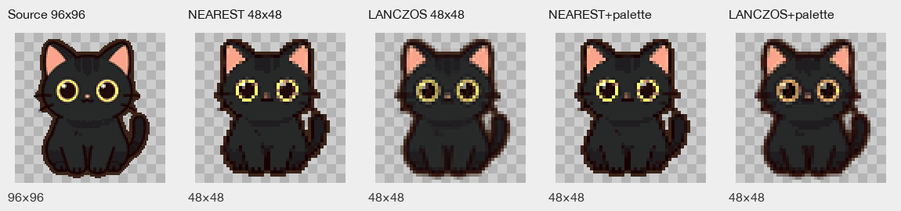

# Asset metadata and resampling evidence

**Audit basis:** f66f9b59ff220523419674601e711f5f74605e92; content/assets.json v1 (65 manifest entries). Read-only audit; no source asset, manifest, loader, or runtime was changed.

Manifest inventory: **45 file-backed**, **1 mirror reference**, **19 entries without a file**. PNG alpha bounds use nonzero-alpha, half-open coordinates [x0,y0…x1,y1); α>0 counts visible pixels; partial counts 0<α<255. For density d, nominal display size is PNG size / d (configured scale, not visible subject bounds).

BootScene.preload queues every file-backed manifest entry. Consumer labels are traced from ID namespaces through content/rigs.json, content/tools.json, BootScene.ts, MapScene.ts, character-rig.ts, and animal-art.ts; dynamic consumers are marked where static lookup did not resolve them.

## Manifest inventory

| Asset key | File | Dimensions / density / nominal display | Alpha bounds | Rig and origin/offset (when applicable); consumer |
|---|---|---|---|---|---|
| tile.grass | public/assets/tiles/grass-2x.png | 128×128; d=2; display 64×64 | 0,0–128,128; α>0 16384/16384; partial 0 | —; — | BootScene → MapScene |
| tile.field | public/assets/tiles/field-2x.png | 128×128; d=2; display 64×64 | 0,0–128,128; α>0 16384/16384; partial 0 | —; — | BootScene → MapScene |
| tile.path | public/assets/tiles/path-2x.png | 128×128; d=2; display 64×64 | 0,0–128,128; α>0 16384/16384; partial 0 | —; — | BootScene → MapScene |
| tile.wall | public/assets/tiles/wall-2x.png | 128×128; d=2; display 64×64 | 0,0–128,128; α>0 16384/16384; partial 0 | —; — | BootScene → MapScene |
| tile.bed | public/assets/tiles/bed-2x.png | 128×128; d=2; display 64×64 | 13,0–108,125; α>0 6347/16384; partial 6314 | —; — | BootScene → MapScene |
| tile.shipbox | public/assets/tiles/shipbox-2x.png | 128×128; d=2; display 64×64 | 9,4–123,127; α>0 8904/16384; partial 8901 | —; — | BootScene → MapScene |
| tile.door | public/assets/tiles/door-2x.png | 128×128; d=2; display 64×64 | 7,6–103,122; α>0 8168/16384; partial 8151 | —; — | BootScene → MapScene |
| tile.soil | public/assets/tiles/soil-2x.png | 128×128; d=2; display 64×64 | 0,0–128,128; α>0 16384/16384; partial 0 | —; — | BootScene → MapScene |
| crop.sweet-radish | — | generated 64×64 fallback; d=n/a | Graphics, no PNG | —; — | BootScene → MapScene |
| crop.moon-bean | — | generated 64×64 fallback; d=n/a | Graphics, no PNG | —; — | BootScene → MapScene |
| crop.star-pepper | — | generated 64×64 fallback; d=n/a | Graphics, no PNG | —; — | BootScene → MapScene |
| crop.golden-rice | — | generated 64×64 fallback; d=n/a | Graphics, no PNG | —; — | BootScene → MapScene |
| crop.bell-pumpkin | — | generated 64×64 fallback; d=n/a | Graphics, no PNG | —; — | BootScene → MapScene |
| crop.maple-berry | — | generated 64×64 fallback; d=n/a | Graphics, no PNG | —; — | BootScene → MapScene |
| crop.snow-radish | — | generated 64×64 fallback; d=n/a | Graphics, no PNG | —; — | BootScene → MapScene |
| crop.frost-mushroom | — | generated 64×64 fallback; d=n/a | Graphics, no PNG | —; — | BootScene → MapScene |
| crop.ember-onion | — | generated 64×64 fallback; d=n/a | Graphics, no PNG | —; — | BootScene → MapScene |
| player.up | public/assets/characters/xiaohan-back-2x.png | 128×160; d=2; display 64×80 | 27,11–105,153; α>0 6723/20480; partial 3 | biped 128×160; legTop=130; splits D/U/L=60/60/62; origin 0,0; feet-aligned root; no per-PNG pivot | BootScene → rigs/companions → character-rig |
| player.down | public/assets/characters/xiaohan-2x.png | 128×160; d=2; display 64×80 | 14,11–121,154; α>0 7097/20480; partial 39 | biped 128×160; legTop=130; splits D/U/L=60/60/62; origin 0,0; feet-aligned root; no per-PNG pivot | BootScene → rigs/companions → character-rig |
| player.left | public/assets/characters/xiaohan-side-2x.png | 128×160; d=2; display 64×80 | 30,13–102,154; α>0 6110/20480; partial 4 | biped 128×160; legTop=130; splits D/U/L=60/60/62; origin 0,0; feet-aligned root; no per-PNG pivot | BootScene → rigs/companions → character-rig |
| player.right | — | mirror; source density | source asset | biped; same as player.left; horizontal mirror of player.left | BootScene → rigs/companions → character-rig |
| npc.maomao | public/assets/characters/maomao-2x.png | 128×160; d=2; display 64×80 | 9,7–117,155; α>0 7419/20480; partial 28 | single 128×160; origin 0,0; no per-PNG offset declared | BootScene → rigs/companions → character-rig |
| npc.rong-bo | public/assets/characters/npc-rong-bo-2x.png | 128×160; d=2; display 64×80 | 25,11–105,153; α>0 6463/20480; partial 45 | single 128×160; origin 0,0; no per-PNG offset declared | BootScene → rigs/companions → character-rig |
| npc.a-gan | public/assets/characters/npc-a-gan-2x.png | 128×160; d=2; display 64×80 | 31,11–99,154; α>0 6591/20480; partial 1 | single 128×160; origin 0,0; no per-PNG offset declared | BootScene → rigs/companions → character-rig |
| npc.shi-shifu | public/assets/characters/npc-shi-shifu-2x.png | 128×160; d=2; display 64×80 | 14,16–121,150; α>0 8285/20480; partial 12 | single 128×160; origin 0,0; no per-PNG offset declared | BootScene → rigs/companions → character-rig |
| npc.zhi-lan | public/assets/characters/npc-zhi-lan-2x.png | 128×160; d=2; display 64×80 | 9,11–108,151; α>0 6683/20480; partial 3 | single 128×160; origin 0,0; no per-PNG offset declared | BootScene → rigs/companions → character-rig |
| npc.xiao-sui | public/assets/characters/npc-xiao-sui-2x.png | 128×160; d=2; display 64×80 | 18,7–112,154; α>0 7202/20480; partial 6 | single 128×160; origin 0,0; no per-PNG offset declared | BootScene → rigs/companions → character-rig |
| crop.dew-grass | — | generated 64×64 fallback; d=n/a | Graphics, no PNG | —; — | BootScene → MapScene |
| crop.dusk-potato | — | generated 64×64 fallback; d=n/a | Graphics, no PNG | —; — | BootScene → MapScene |
| crop.silver-wheat | — | generated 64×64 fallback; d=n/a | Graphics, no PNG | —; — | BootScene → MapScene |
| pet.cat | public/assets/characters/cat-2x.png | 96×96; d=2; display 48×48 | 11,4–86,93; α>0 5141/9216; partial 101 | hop 96×96; origin 0,0; no per-PNG offset declared | BootScene → rigs/companions → character-rig |
| pet.marsupial | public/assets/characters/marsupial-2x.png | 96×96; d=2; display 48×48 | 5,14–86,91; α>0 3485/9216; partial 46 | hop 96×96; origin 0,0; no per-PNG offset declared | BootScene → rigs/companions → character-rig |
| tool.hoe | public/assets/tools/hoe-2x.png | 192×192; d=2; display 96×96 | 10,16–184,183; α>0 6109/36864; partial 8 | tool 96×96; grip 42,68 px | BootScene → tools.json → character-rig |
| tool.can | public/assets/tools/can-2x.png | 192×192; d=2; display 96×96 | 11,21–185,180; α>0 10901/36864; partial 240 | tool 96×96; grip 10,58 px | BootScene → tools.json → character-rig |
| tool.seedbag | public/assets/tools/seedbag-2x.png | 192×192; d=2; display 96×96 | 30,49–164,180; α>0 8705/36864; partial 5 | tool 96×96; grip 50,30 px | BootScene → tools.json → character-rig |
| tile.tree | public/assets/tiles/tree-2x.png | 128×128; d=2; display 64×64 | 10,9–115,123; α>0 7073/16384; partial 7059 | —; — | BootScene → MapScene |
| tile.water | public/assets/tiles/water-2x.png | 128×128; d=2; display 64×64 | 0,0–128,128; α>0 16384/16384; partial 0 | —; — | BootScene → MapScene |
| tile.floor | public/assets/tiles/floor-2x.png | 128×128; d=2; display 64×64 | 0,0–128,128; α>0 16384/16384; partial 0 | —; — | BootScene → MapScene |
| tile.furniture | public/assets/tiles/furniture-2x.png | 128×128; d=2; display 64×64 | 6,2–110,110; α>0 4466/16384; partial 4462 | —; — | BootScene → MapScene |
| tile.cave | public/assets/tiles/cave-2x.png | 128×128; d=2; display 64×64 | 0,0–128,128; α>0 16384/16384; partial 0 | —; — | BootScene → MapScene |
| tile.rock | public/assets/tiles/rock-2x.png | 128×128; d=2; display 64×64 | 26,21–102,112; α>0 3953/16384; partial 3944 | —; — | BootScene → MapScene |
| tool.axe | public/assets/tools/axe-2x.png | 192×192; d=2; display 96×96 | 13,26–187,185; α>0 7508/36864; partial 19 | tool 96×96; grip 42,68 px | BootScene → tools.json → character-rig |
| tile.shop | public/assets/tiles/shop-2x.png | 128×128; d=2; display 64×64 | 14,0–125,127; α>0 7166/16384; partial 7154 | —; — | BootScene → MapScene |
| tile.forage | public/assets/tiles/forage-2x.png | 128×128; d=2; display 64×64 | 3,20–123,115; α>0 4358/16384; partial 4343 | —; — | BootScene → MapScene |
| tool.pick | public/assets/tools/pick-2x.png | 192×192; d=2; display 96×96 | 7,19–171,178; α>0 8663/36864; partial 2 | tool 96×96; grip 42,68 px | BootScene → tools.json → character-rig |
| tile.ore | public/assets/tiles/ore-2x.png | 128×128; d=2; display 64×64 | 11,13–118,126; α>0 7614/16384; partial 7599 | —; — | BootScene → MapScene |
| tile.stairs | public/assets/tiles/stairs-2x.png | 128×128; d=2; display 64×64 | 18,6–124,122; α>0 6733/16384; partial 6727 | —; — | BootScene → MapScene |
| tool.rod | public/assets/tools/rod-2x.png | 192×192; d=2; display 96×96 | 33,20–171,163; α>0 5730/36864; partial 17 | tool 96×96; grip 42,68 px | BootScene → tools.json → character-rig |
| tile.trough | public/assets/tiles/trough-2x.png | 128×128; d=2; display 64×64 | 16,46–111,102; α>0 3551/16384; partial 3551 | —; — | BootScene → MapScene |
| tile.kitchen | public/assets/tiles/kitchen-2x.png | 128×128; d=2; display 64×64 | 11,11–116,115; α>0 8018/16384; partial 8007 | —; — | BootScene → MapScene |
| tile.workshop | public/assets/tiles/workshop-2x.png | 128×128; d=2; display 64×64 | 2,8–122,120; α>0 8483/16384; partial 8479 | —; — | BootScene → MapScene |
| tile.workbench | public/assets/tiles/workbench-2x.png | 128×128; d=2; display 64×64 | 6,5–127,123; α>0 7754/16384; partial 7722 | —; — | BootScene → MapScene |
| tile.tuft | public/assets/tiles/tuft-2x.png | 128×128; d=2; display 64×64 | 24,31–108,118; α>0 3122/16384; partial 3105 | —; — | BootScene → MapScene |
| tool.sickle | public/assets/tools/sickle-2x.png | 192×192; d=2; display 96×96 | 32,39–163,181; α>0 5395/36864; partial 1 | tool 96×96; grip 42,68 px | BootScene → tools.json → character-rig |
| tile.fence | public/assets/tiles/fence-2x.png | 128×128; d=2; display 64×64 | 11,24–126,103; α>0 4202/16384; partial 4202 | —; — | BootScene → MapScene |
| animal.cow | — | generated 32×32 (animal-art); d=n/a | Graphics texture, no PNG | —; — | BootScene → animal-art; MapScene livestock |
| item.milk | — | generated 64×64 fallback; d=n/a | Graphics, no PNG | —; — | BootScene fallback; UI consumer unresolved |
| item.cheese | — | generated 64×64 fallback; d=n/a | Graphics, no PNG | —; — | BootScene fallback; UI consumer unresolved |
| item.butter | — | generated 64×64 fallback; d=n/a | Graphics, no PNG | —; — | BootScene fallback; UI consumer unresolved |
| animal.sheep | — | generated 32×32 (animal-art); d=n/a | Graphics texture, no PNG | —; — | BootScene → animal-art; MapScene livestock |
| item.wool | — | generated 64×64 fallback; d=n/a | Graphics, no PNG | —; — | BootScene fallback; UI consumer unresolved |
| item.cloth | — | generated 64×64 fallback; d=n/a | Graphics, no PNG | —; — | BootScene fallback; UI consumer unresolved |
| pwa.icon-192 | public/assets/icons/icon-192.png | 192×192; d=n/a; PWA icon | 0,0–192,192; α>0 36864/36864; partial 0 | —; — | BootScene; web app manifest |
| pwa.icon-512 | public/assets/icons/icon-512.png | 512×512; d=n/a; PWA icon | 0,0–512,512; α>0 262144/262144; partial 0 | —; — | BootScene; web app manifest |
| pwa.icon-maskable-512 | public/assets/icons/icon-maskable-512.png | 512×512; d=n/a; PWA icon | 0,0–512,512; α>0 262144/262144; partial 0 | —; — | BootScene; web app manifest |

Notes:
- player.right has no separate PNG; it mirrors player.left at runtime.
- Character images use origin (0,0) in character-rig.ts; rigs declare frame size, split/hand values and tool grip points, but no universal PNG pivot. Hop/single rigs have no per-asset pixel offset.
- Player biped rig is 128×160 with legTop=130, D/U/L splits 60/60/62, and facing-specific hand points in content/rigs.json. Table records split locations; it does not infer pixel-level foot-anchor quality.
- Tools use content/tools.json 96×96 logical texture declarations and grip points; the file-backed 192×192 source at density 2 renders at 96×96 logical pixels.
- Entries without file are not PNGs. BootScene draws standard fallbacks at TILE_SIZE=64; cow/sheep textures are registered at 32×32 by animal-art.ts before fallback. Graphics bounds and dynamic inventory UI use are not measured.
- PWA icon roles are declared by public/manifest.webmanifest (192×192 or 512×512); density is not applicable as a game-sprite scale.

## Same-source resampling A/B

Same tracked source, public/assets/characters/cat-2x.png (96×96; SHA-256 e128d8295d4d1fc8cf3ff52dc70d176b3b0ea8b6087a6f350b6feeef4c8468e5), downsampled to 48×48 using Pillow NEAREST and LANCZOS. Each output was also mapped without dithering to the 112-color project palette from content/palette.json, preserving resized alpha. The 48×48 variants are enlarged 4× with NEAREST; the 96×96 source is shown at 2×. Enlargement is only for inspection.

| Variant | Unique visible RGB colors | Partial-alpha pixels | Mean RGB absolute difference vs NEAREST, nontransparent pixels | Pixel SHA-256 |
|---|---:|---:|---:|---|
| NEAREST | 30 | 27 | 0.00 | 56e97b660dfaf3a4 |
| LANCZOS | 811 | 538 | 8.63 | 65b4b7f0bc98134c |
| NEAREST + palette | 30 | 27 | 0.00 | 56e97b660dfaf3a4 |
| LANCZOS + palette | 50 | 538 | 7.88 | 28d9e0d862d771fd |

Contact-sheet SHA-256: c539873bcad8a2a990192dfc10c1f269a3d3da6417b60452705b82d08213d83f.

**Observed scope:** on this one source at 48×48, the project-palette mapping is a no-op after NEAREST (identical pixel hash and 30 visible RGB colors), indicating the sampled colors were already in the palette. LANCZOS adds many interpolated RGB values (811 here); palette mapping reduces them to 50, but retains 538 partial-alpha pixels, so quantization does not remove its softened edges. These measurements are not a quality verdict for all assets and do not test Phaser runtime sampling; BootScene currently sets Phaser Textures FilterMode.NEAREST. tools/art/finalize.py itself uses NEAREST plus a one-pixel-at-1× outline; the restored cat is a legacy source and did not pass through that finalizer in this branch. Quantization is not inherently required for RGBA8888 assets. Final style choice remains a human visual decision.

## Limits

- File dimensions, alpha bounds, density, and rig links were measured/traced; consumer labels are static-code discoveries, not runtime coverage.
- Metadata does not establish silhouette quality, foot/collision alignment, crop rendering, animation identity, or source rights.
- No files under public/assets, content, src, or tools were edited.
