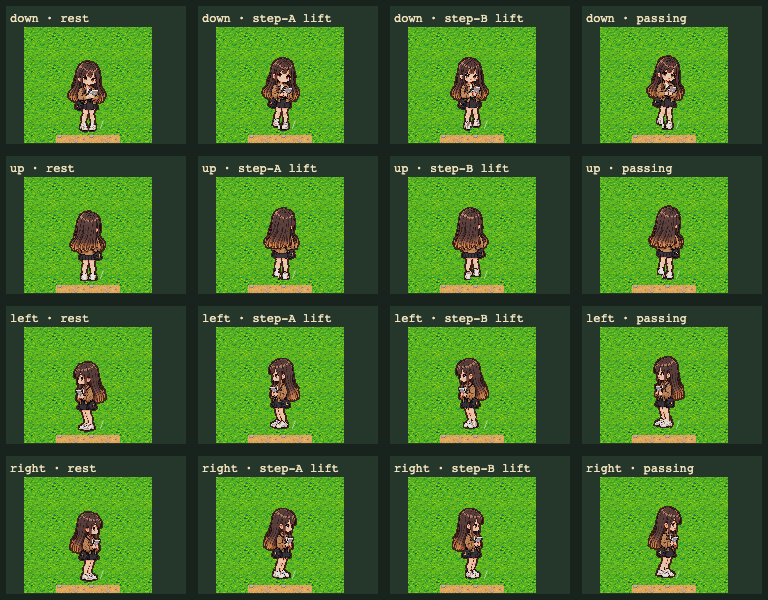
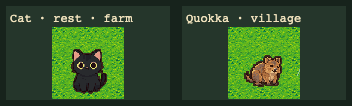

# VF-15 正式角色 runtime 接觸表

這份證據只擷取正式遊戲載入的角色素材，不讀取、不整合任何未核准候選圖。接觸表由 Playwright E2E 在 1280×720 Chromium 視窗中產生；重新產生方式：

```bash
SAVE_VF15_CONTACT_SHEETS=1 npm run test:e2e -- tests/e2e/formal-runtime-contact-sheets.spec.ts --workers=1
```

`evidence.json` 記錄瀏覽器、renderer、素材來源 SHA-256、畫格姿勢、接觸表 SHA-256。固定測試用亂數種子、等待相機停止移動並暫停場景後取樣；在同一環境連跑兩次，兩張 PNG 都逐位元相同。

## 玩家四方向與走路姿勢



- 4 列方向：正面、背面、左側、右側；右側由正式左側素材鏡像。
- 4 欄姿勢：站立、第一步抬腳、第二步抬腳、步態通過相位。
- 圖片 SHA-256：`7d6c7e044289ae4ac270865fea9f0ead20c3dcee87531169ace819a0e347556c`
- 人工檢視：16 個畫格均看得到完整頭身與腳部切塊，這次 Chromium 畫面沒有明顯貼圖破裂；站立腳底與地面基準對齊，步態欄呈現抬腳。這是接觸表範圍內的目視結果，不是跨裝置或整個走路期間的視覺保證。

## 黑貓與矮袋鼠輪廓



- 左：農場黑貓站姿；右：村莊矮袋鼠（Quokka）站姿。玩家隱藏後，以 72×72 畫面近景擷取。
- 圖片 SHA-256：`f40fd34eee7cab3dfb32b307c836854e6e5da7a061cd997038b3f93eff087150`
- 人工檢視：黑貓可見尖耳、黑色四足身形與眼睛；矮袋鼠呈棕色、低伏的四足輪廓。這份接觸表只證明所示場景與站姿的可見輪廓；不涵蓋新動畫幀、其他方向、外部裝置或使用者對新素材的核准。
- 黑貓跳躍行為仍由既有 `tests/e2e/companions.spec.ts` 驗收。本接觸表刻意不保存時間敏感的 tween 畫格，避免不同 Chromium 採樣時點產生不一致的證據 PNG。

## Runtime 與素材來源

- Chromium：Playwright Chromium 156.0.8078.4；renderer 是 SwiftShader，`software: true`，現有相容性 workaround 已啟用。
- Runtime texture 尺寸：玩家各方向來源 128×160；寵物來源 96×96（實際寵物顯示 48×48）。玩家右側鏡像正式左側素材。
- 本次檢視沒有勾選或更新 `docs/art/pet-anatomy-checklist.md`：接觸表是有限視角的 runtime 證據，不構成清單上各解剖細節的逐項簽核或使用者核准。

| Asset key | Runtime 檔案 | Source SHA-256 |
|---|---|---|
| `player.down` | `public/assets/characters/xiaohan-2x.png` | `e7f19903932679bdc378d70fab1cc407e82e0c2a03ad557623f8e7bbfd3d85e1` |
| `player.up` | `public/assets/characters/xiaohan-back-2x.png` | `7957c0064392269cc4edfbb8ffd1f470bff6c1ae71a10ba929f9eaaa7976b300` |
| `player.left` / mirrored `player.right` | `public/assets/characters/xiaohan-side-2x.png` | `067293dbe2d12d7ec1f620f7c5b073ddd9971afd3138d782ce8d7ec94f3909a8` |
| `pet.cat` | `public/assets/characters/cat-2x.png` | `e128d8295d4d1fc8cf3ff52dc70d176b3b0ea8b6087a6f350b6feeef4c8468e5` |
| `pet.marsupial` | `public/assets/characters/marsupial-2x.png` | `614fc13c48dab042962c7dc39f2353890d5f038e04076205a99cad27aed822d7` |

## 驗證與限制

- `npm run typecheck`：通過。
- `npx playwright test tests/e2e/formal-runtime-contact-sheets.spec.ts --workers=1`：重複執行均 1/1 通過；兩張正式保存 PNG 的 SHA-256 在兩次執行間相同。
- `npm run assets:gate1:animation:check`：通過。這項 gate 檢查未核准 Pixel32 候選檔的結構／產生結果，不代表候選素材獲准進 runtime。
- `npm run assets:gate1:pets:check`：通過。這項 gate 檢查候選寵物資產，不代表候選素材獲准進 runtime。
- 渲染證據只來自一種 Chromium SwiftShader 模擬環境；尚未驗證實體裝置、其他 GPU／瀏覽器、效能、完整動畫時間序列或所有姿勢的逐項人工簽核。
- Repository-wide AIPS Impact Graph 的 API、資料、事件及 consumer coverage 仍為 partial/unknown；本次只人工核對既有 MapScene debug surface、角色 E2E patterns 和 Playwright test discovery。
