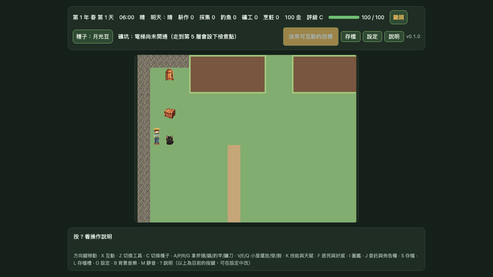
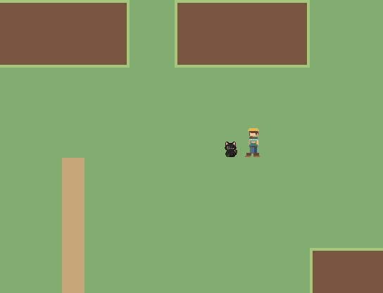
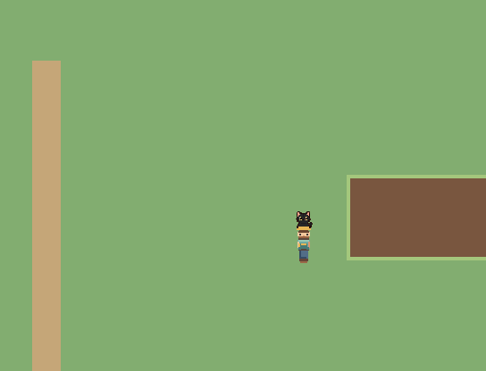
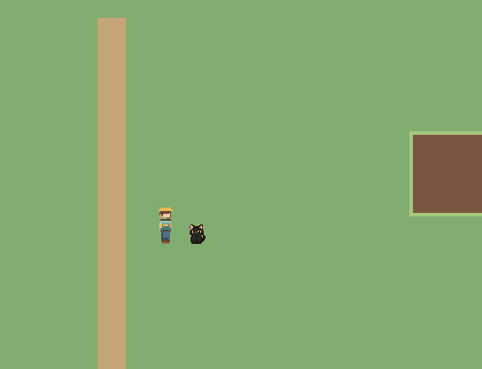
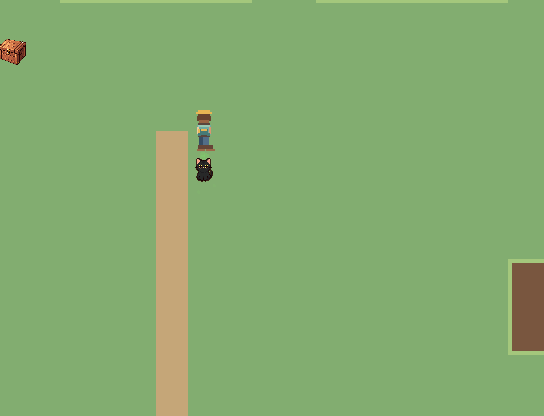
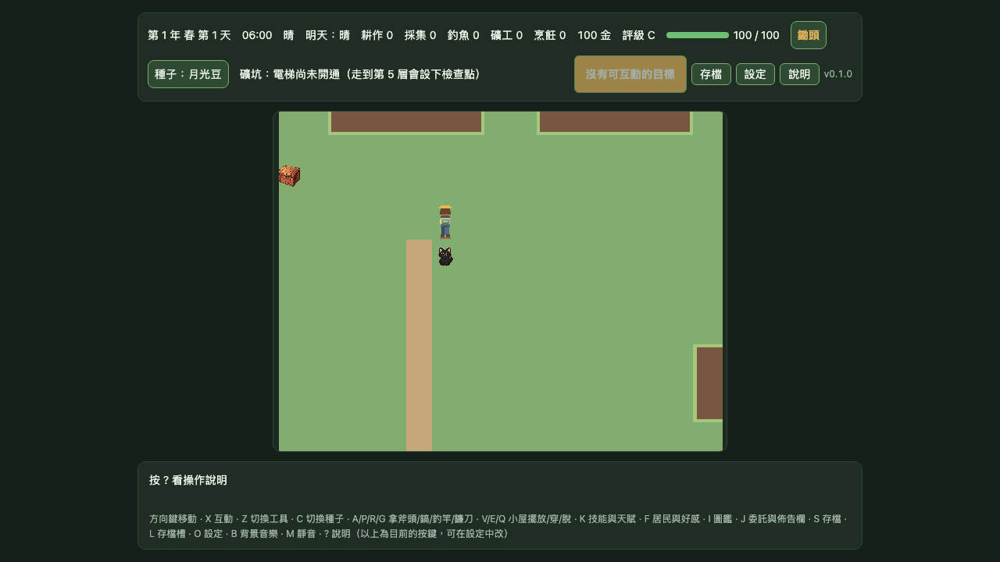

# Pixel32 候選 MapScene 連續移動與碰撞證據

> **狀態：DEV-only Chromium 候選證據完成；素材仍為 `candidate`／`approved: false`，Gate 1 未通過。**

## 測試範圍

- 使用 farm `MapScene` 與明確候選 opt-in：`?renderProfile=pixel32&gate1Runtime=pixel32-map-animation`。
- viewport 為 1280×720 CSS pixels、Chromium DPR 1；玩家起點為 `(7, 9)`。
- 先按住左方向直到西側牆面，確認停在 `(1, 9)` 且 250 ms 內位置不再變動；接著回到起點。
- 接續依序按住右、下、左、上各 1,250 ms，合計按住輸入 5,000 ms。每個方向至少移動 7 格，且觀察到對應 pixel32 候選走路幀；此測試未量測方向鍵切換間的零間隔。
- 每張方向影格均於對應按鍵持續按住時擷取；按鍵保持時間、位移格數、動畫幀名稱及檔案 hashes 都記入證據 JSON。

## 結果

| 方向 | 按住時間 | 移動格數 | 觀察到的候選動畫幀 |
|---|---:|---:|---|
| 右 | 1,250 ms | 8 | `right-passing`、`right-contact-a/b` |
| 下 | 1,250 ms | 8 | `down-passing`、`down-contact-a/b` |
| 左 | 1,250 ms | 9 | `left-passing`、`left-contact-a/b` |
| 上 | 1,250 ms | 7 | `up-passing`、`up-contact-a/b` |
| 西側牆面 | 持續按住至阻擋 | `(7,9)` → `(1,9)` | 被牆阻擋；等候 250 ms 座標穩定 |

四方向每段最少按住 **1,250 ms**，合計至少 **5,000 ms**；證據 JSON 記錄每段實測按住時間，以及最後一段移動收尾的總觀測時間，避免把輸入時間與動畫收尾時間混為一談。

## 動作影格



每張方向圖是在對應按鍵仍按住時直接從遊戲 canvas 擷取，可與自動化測得的移動格數及動畫幀互相核對。







完整數值與每張 PNG 的位元組數及 SHA-256 在 [`evidence.json`](gate1-mapscene-pixel32-motion-evidence/evidence.json)。連續移動與碰撞行為由 Playwright 在 5 秒以上的實際按鍵保持期間逐幀檢查；這些靜態影格是補充視覺證據。

## 重現

```bash
SAVE_GATE1_PIXEL32_MOTION_EVIDENCE=1 \
E2E_BASE_URL=http://127.0.0.1:5183 \
PWA_BASE_URL=http://127.0.0.1:4183 \
NO_PROXY=127.0.0.1,localhost \
no_proxy=127.0.0.1,localhost \
npm run test:e2e -- tests/e2e/gate1-mapscene-pixel32-motion-evidence.spec.ts
```

## 限制與後續

- 這只證明目前 DEV 候選路徑在模擬 Chromium 中呈現四向持續移動，並保留 farm 西側牆的碰撞；不代表 iOS／Android 實機驗收。
- 圖片由 Chromium 擷取。測試不提供連續影片，也未測量實機 FPS 或長時間效能。
- 地圖、存檔、碰撞規則與正式素材沒有變更；候選圖集仍未核准。畫面中未覆蓋的房屋、樹木、作物、NPC、夥伴與工具仍使用舊素材。
- Gate 1 尚缺完整 12×10 runtime 組合、作物與夥伴辨識、農務動畫、樹冠／建築遮擋、各 viewport/DPR 動作比較及原生實機測試。
