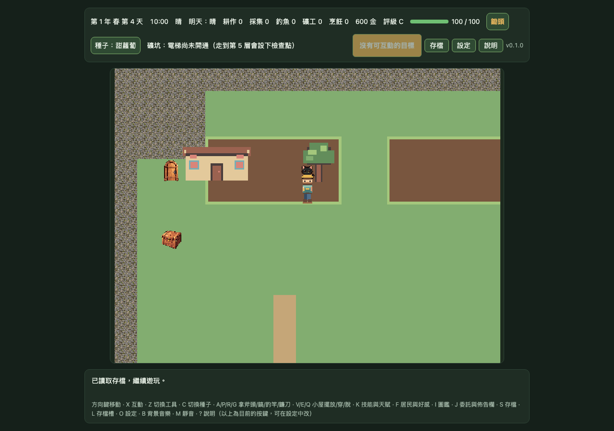
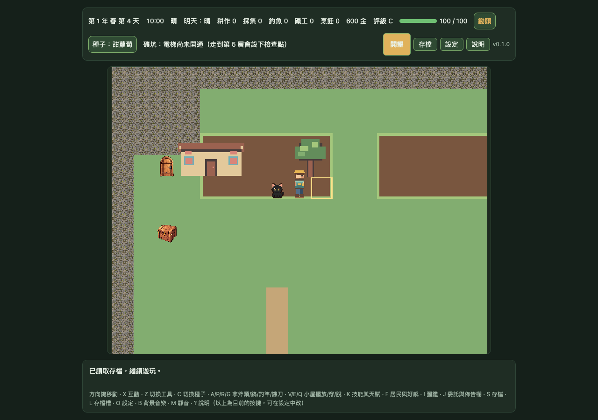

# DF-G1-OVERLAY-MOTION-STABILITY｜pixel32 房屋／樹冠移動深度穩定性

## 範圍

使用隔離 IndexedDB QA 存檔與精確 DEV-only pixel32 MapScene／overlay opt-in，在 farm 場景中讓角色沿樹冠南北與左右、房屋前後錨點移動，共 14 次單格移動、15 個狀態樣本。逐步記錄玩家格位、腳底 Y、深度、方向閒置動畫幀，以及房屋底層、樹冠、房屋前景三個候選 overlay 的層、深度、可見狀態。

候選地圖及角色動畫 manifest 都維持 `status: candidate`、`approved: false`。本工作只新增 E2E 與證據文件，沒有變更正式素材、地圖、碰撞、存檔 schema 或玩法；不代表美術核准、完整場景驗收或 Gate 1 通過。

## 結果

- 15 個樣本中，house-back、tree-canopy、house-front 的數量、順序、圖層、可見狀態及深度保持穩定。
- 玩家走到樹冠腳底錨點北側時，角色深度低於樹冠；走到南側後高於樹冠。
- 玩家走到房屋前景腳底錨點北側時，角色深度低於房屋前景；走到南側後高於房屋前景。
- 每次單格移動後均等候 movement queue 閒置才取樣；四個方向的移動均成功。
- 候選 atlas 請求成功；request failure、HTTP failure、page error 均為 0。
- 每個樣本的 `id`、`frame`、`layer`、tile、depth、display list 與 visible signature 都逐一比對起始樣本。

## 候選輸入 SHA-256

| 輸入 | SHA-256 |
| --- | --- |
| pixel32 map manifest | `3a179659310f657b70bfd5a929e671d8fbce340e241fe16fbb90bb5d5b27c9ea` |
| pixel32 map atlas | `64418c1bb8099a821ff32fd520bf3680e7416b4d99e8a50f84f1da05125a2184` |
| pixel32 animation manifest | `ebeb2be797d5e6b16d643aeb8a2e7d8b090fc427099d892957b94f2f626692f8` |
| pixel32 animation atlas | `15ad5e872025c19baf5337cb3e08567d4665fdaba2ee68126bf07d8b893c00a3` |

## 截圖

畫面為 1280×900、DPR 1 的 Chromium CSS-scale 截圖。逐格測量與每張截圖 SHA-256 收錄於 [evidence.json](./gate1-mapscene-pixel32-overlay-motion-stability/evidence.json)。

## 驗收界線

- 專項 Chromium Playwright E2E 通過 1/1。
- `npm run check` 通過：159 個測試檔，1,616 passed／1 skipped；assets、TypeScript、production build 與 8 MB 預算通過（2.799 MB）。
- 完整 Chromium Playwright E2E 通過 232/232（4 workers，7.4 分鐘）；既有 software-renderer canary 的預期失敗依測試契約計為通過。
- 深度翻轉是目前 DEV-only 候選位置的機器可測訊號，不是遮蔽像素品質或美術品質評分。
- 本切片只在 DEV candidate route 執行；正式素材未變更是依本次檔案差異確認，不是本測試另行啟動 production build 驗證。
- 沒有涵蓋完整 12×10 可玩場景、所有物件／角色、原生 iOS／Android 顯示或效能；裝置驗證仍是 `DEVICE_PENDING`。
- 確切候選素材仍須由使用者逐版本檢視與明確核准，之後才可評估正式整合。
