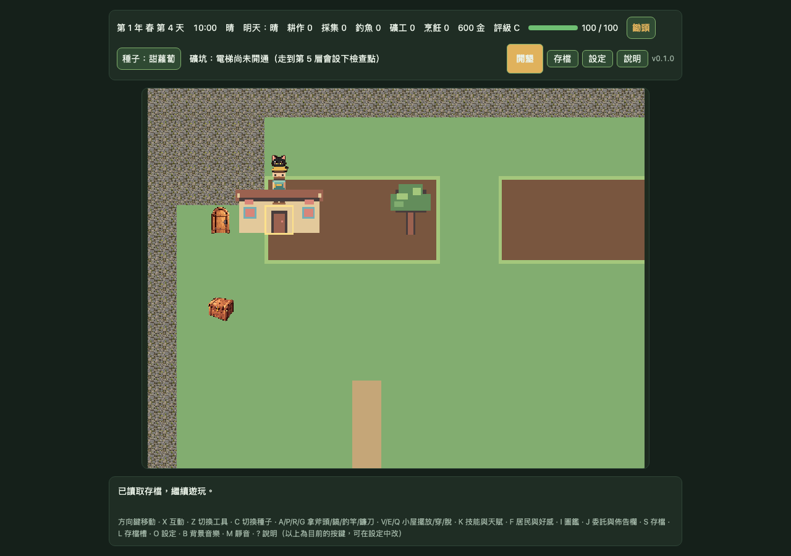
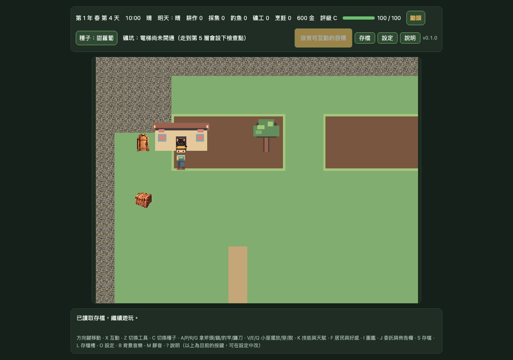

# DF-G1-OVERLAY-OCCLUSION｜pixel32 房屋／樹冠角色遮擋證據

## 範圍

在既有精確 DEV-only pixel32 runtime／overlay opt-in 下，將玩家固定在房屋與樹冠候選層前後的位置，以同一個 Phaser renderer snapshot 分別擷取玩家顯示與隱藏畫面，計算兩張畫面 RGBA 不同的像素數。其餘場景與 overlay 保持不變。候選素材仍為 `candidate`、`approved: false`；本階段不代表 Gate 1 通過，也未修改正式地圖、碰撞、存檔或玩法。

## 量測結果

測試 viewport 為 1280 × 900、device scale factor 1。數值是 renderer 原始 snapshot 中，玩家顯示相對玩家隱藏時發生變化的像素數，以下稱「玩家 snapshot 差分像素」。它不是精確的角色 alpha 遮罩或被遮住面積；與背景同色的角色像素可能不會被計入。

| 候選層 | 玩家位置 | 玩家 snapshot 差分像素 | 比較 |
| --- | --- | ---: | --- |
| 房屋後方 | tile (4, 3) | 374 | — |
| 房屋前方 | tile (4, 5) | 510 | 比後方多 136 |
| 樹冠後方 | tile (8, 3) | 336 | — |
| 樹冠前方 | tile (8, 5) | 510 | 比後方多 174 |

這四個固定位置中，房屋與樹冠前方位置的玩家 snapshot 差分像素都高於各自後方位置，提供目前候選合成的一項方向性畫面訊號。不同座標的背景會影響差分數；因此結果不等於精確遮擋面積或遮罩品質證明，也不是美術品質評分。

## 截圖

完整座標、量測方法、比較結果與每張截圖 SHA-256 見 [evidence.json](./gate1-mapscene-pixel32-overlay-occlusion/evidence.json)。測試以固定存檔座標載入 farm 場景、凍結玩家姿勢，再做 renderer snapshot；不比較不同 Phaser display list 的 depth 數值。

## 驗收與限制

- 專項 Chromium Playwright E2E：1/1 通過；對房屋與樹冠分別確認固定前方位置的 snapshot 差分數高於後方位置。
- `npm run check` 通過：159 個測試檔、1,616 passed／1 skipped，build 與 8 MB 預算通過。
- 完整 Playwright E2E：230/230 通過（4 workers）。
- 尚未做原生裝置驗證、確切素材的人眼核准或 Gate 1 整體驗收；候選素材仍未核准。
