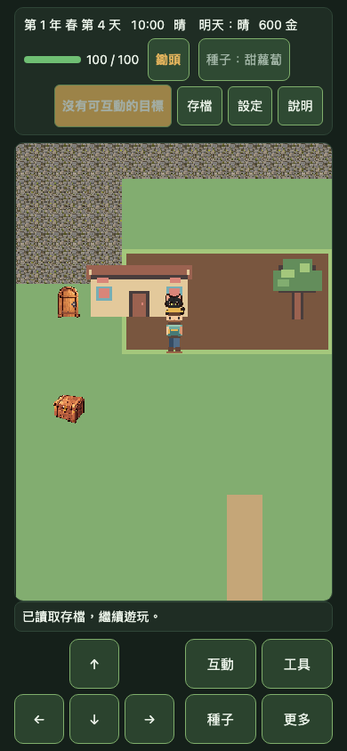
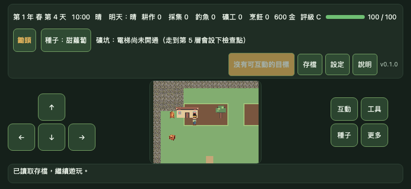
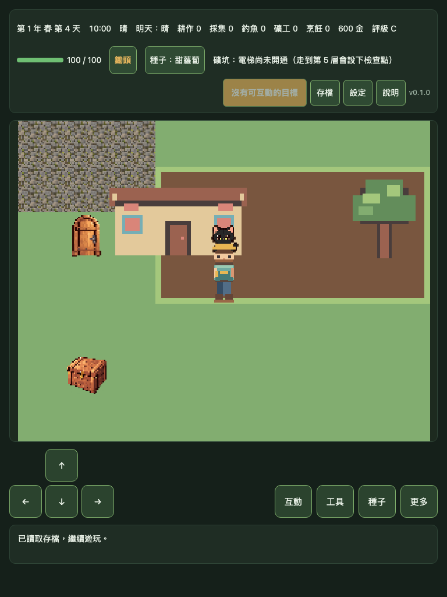
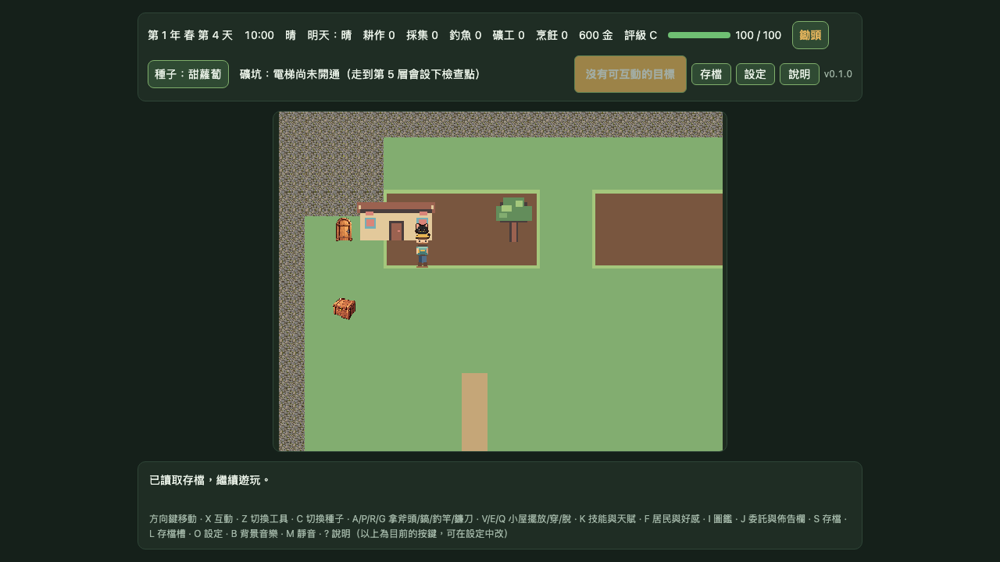
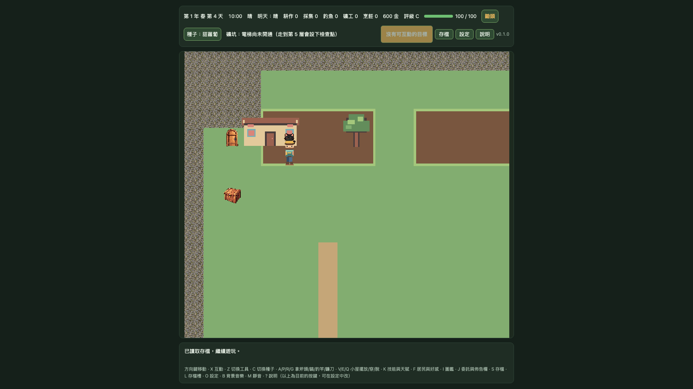

# DF-G1-OVERLAY-RUNTIME-MATRIX｜pixel32 房屋／樹冠候選 viewport／DPR 證據

> **狀態：15 組 Chromium 模擬擷取完成；候選仍未核准，Gate 1 未通過。** 本報告只驗證精確 DEV-only MapScene 與房屋／樹冠候選圖層在五種 viewport、DPR 1／2／3 下能載入及保存畫面。

## 範圍

- 使用 `?renderProfile=pixel32&gate1Runtime=pixel32-map-animation&gate1OverlayPreview=pixel32-overlay-12x10`，在同一 farm `MapScene` 顯示 `house-back`、`tree-canopy` 與 `house-front`。
- 每個隔離 Chromium context 寫入一次性 QA 存檔並驗證玩家固定在 `(5,5)`，避免預設出生點讓 overlay 在小 viewport 鏡頭外。
- 沿用既有 pixel32 map／animation 候選 manifest 和圖集；檢查候選狀態、圖層 frame、layer、display list、固定 tile 座標、Canvas／render resolution、可見格數及 browser DPR。
- 每個 viewport／DPR context 確認候選資產請求成功、無 page error，再保存一張 CSS 尺寸截圖與 SHA-256。
- 報告與 15 張 PNG 的完整量測、候選來源雜湊及限制見 [`evidence.json`](./gate1-mapscene-pixel32-overlay-runtime-matrix/evidence.json)。

## 代表畫面

以下均為 Chromium DPR 2 context 的 CSS 尺寸截圖；它們不是原生裝置或 DPR 專屬 raster 擷取。

| Viewport | Canvas render resolution | 可見遊戲格 | 截圖 |
| --- | ---: | ---: | --- |
| 手機直式 390×844 | 288×416 | 9×13 |  |
| 手機橫式 844×390 | 448×352 | 14×11 |  |
| 平板直式 768×1024 | 288×224 | 9×7 |  |
| 桌面 1280×720 | 544×416 | 17×13 |  |
| 桌面 Full HD 1920×1080 | 544×480 | 17×15 |  |

目視檢查上述 5 張 DPR 2 代表圖；其餘 10 張以測試中的 overlay layer／asset load assertions 與 PNG SHA-256 machine-check。五種 viewport 的代表截圖都可見候選 house／tree 與玩家。這只是截圖完整性與呈現位置的 QA 記錄，不是可讀性、像素品質、無縫拼接、遮擋品質或美術核准評分。

## 驗證

```bash
SAVE_GATE1_PIXEL32_OVERLAY_RUNTIME_EVIDENCE=1 \
E2E_BASE_URL=http://127.0.0.1:5183 \
PWA_BASE_URL=http://127.0.0.1:4174 \
npm run test:e2e -- tests/e2e/gate1-mapscene-pixel32-overlay-runtime-matrix.spec.ts --workers=1
```

- 專項 Playwright E2E：1/1 測試通過，涵蓋 15 個 viewport／DPR context。
- `npm run check` 通過：159 個單元測試檔，1,616 passed／1 skipped；production build 與 8 MB 首次載入預算通過。
- 完整 Chromium Playwright E2E：231/231 通過（4 workers，7.2 分鐘）。
- 每一組均確認 farm MapScene、精確 DEV opt-in、玩家 idle frame 與 3 個候選 overlay layer；map／animation manifest 維持 `candidate`、`approved: false`。
- evidence JSON 記錄全部 15 張截圖 SHA-256；重新計算後 15/15 相符，asset request 失敗與 page error 均為 0。
- 截圖使用 `scale: css`；Chromium 的 `deviceScaleFactor` 只作 viewport／DPR 模擬欄位，不能當成實際裝置 raster、iOS／Android 行為或效能證明。

## 未驗收

- 固定完整 12×10 遊戲場景及 legacy／pixel16／pixel32 同 runtime 比較。
- 100% 顯示的 10 情境可讀性評分、逐格 seam／閃爍檢查、像素級遮擋品質與走路 foot-anchor 人工評分。
- 完整候選覆蓋、原生 iOS／Android 安全區／觸控／效能驗證；實機維持 `DEVICE_PENDING`。
- 確切素材版本的人工核准仍未取得；本證據不代表 Gate 1 通過或正式素材整合。
