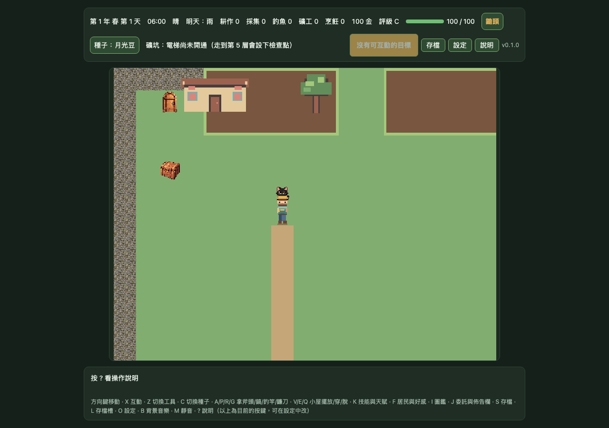

# DF-G1-OVERLAY-12X10｜pixel32 房屋／樹冠圖層候選

## 範圍

以明確的 DEV-only pixel32 runtime opt-in 加入 farm MapScene 候選圖層：`house-back` 放在地圖世界底層；`tree-canopy` 與 `house-front` 依腳底深度繪於前景。另於既有 Gate 1 預覽頁新增固定 12 × 10、原生 32 × 32 的地圖 atlas 圖層樣張。

Runtime 預覽需同時指定 `renderProfile=pixel32`、`gate1Runtime=pixel32-map-animation` 與 `gate1OverlayPreview=pixel32-overlay-12x10`。沒有完整 opt-in 時，候選圖層不會建立。候選 frame 由既有 pixel32 map atlas manifest 載入；素材維持 `status: candidate`、`approved: false`。

本工作沒有更改 `content/assets.json`、正式地圖、碰撞、存檔、玩法或正式 `public/` 素材。候選 sprite 只建立於 MapScene 的視覺圖層，並在地圖重畫和場景結束時清除。

## 預覽

### MapScene runtime（1280 × 900 Chromium）

### 固定 12 × 10 圖層構圖（384 × 320 canvas，1280 × 900 Chromium 頁面）

此頁同時保留既有 A／B 全場景模式；「B · 地圖圖層」只顯示 pixel32 草地、道路、房屋底層／前景片與樹冠，不包含角色及農務物件。頁首、比較項與限制會隨模式更新。

## 驗證

- `npm run check` 通過：候選素材／動畫／地圖檢查、TypeScript、159 個測試檔（1,616 passed、1 skipped）、production build 與 8 MB bundle 預算（總計 2.799 MB）。
- 專項 Playwright E2E 通過 1/1；驗證第二個精確 query 的 DEV opt-in、三個 manifest frame／圖層與 display list、房屋共用錨點、像素邊界、未核准狀態與固定 canvas 尺寸。
- 完整 `npm run test:e2e -- --workers=4` 通過 230/230。9 workers 的先前執行曾使既有夥伴跳躍取樣測試失敗；該測試單獨重跑 1/1，4-worker 完整套件亦通過。`render-compat` software-renderer canary 依既有測試契約預期失敗，不計為失敗測試。
- Chromium 視覺檢查已查看兩張 1280 × 900 截圖。未執行原生裝置測試。

## 證據

完整量測與 SHA-256 記錄於 [evidence.json](./gate1-mapscene-pixel32-overlay-scene/evidence.json)。

| 畫面 | 檔案 | SHA-256 |
|---|---|---|
| MapScene runtime | `pixel32-mapscene-overlays.png` | `9bd484a6f130b16a58b5dea46b0311c174ea51360b6027208cf1454e765bcb8d` |
| 固定場景 | `pixel32-overlays-12x10.png` | `7f15e6e833a85f685ee4bf50e1fa6a779a961deec2fb200bf1112328e015bb73` |

## 限制與後續驗收

- 候選房屋與樹冠畫面及其層次仍需人工審核，尚未核准，也不可視為 Gate 1 通過。
- E2E 記錄深度排序與 bounds，未以 actor 像素遮罩量測新的 canopy／house 遮擋品質。
- 證據來自 Chromium 模擬器；實機尺寸、效能、輸入與可讀性仍待裝置驗收，維持 `DEVICE_PENDING`。
