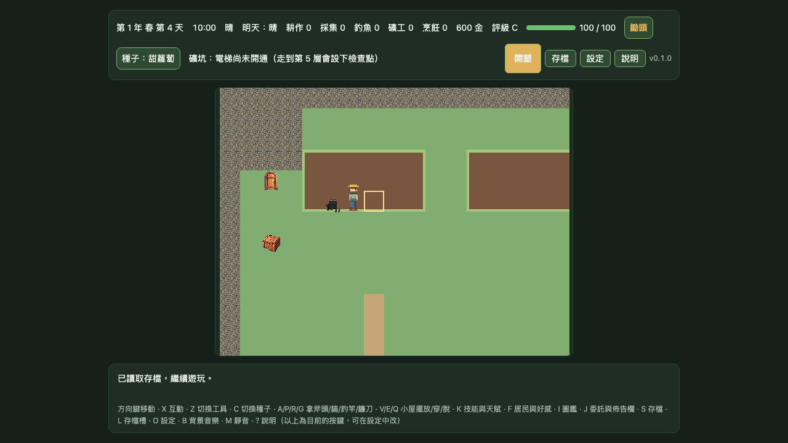
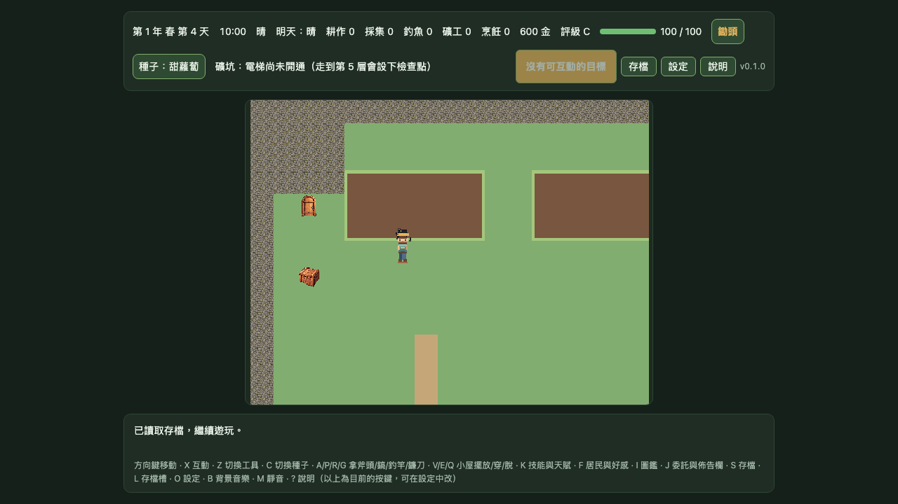
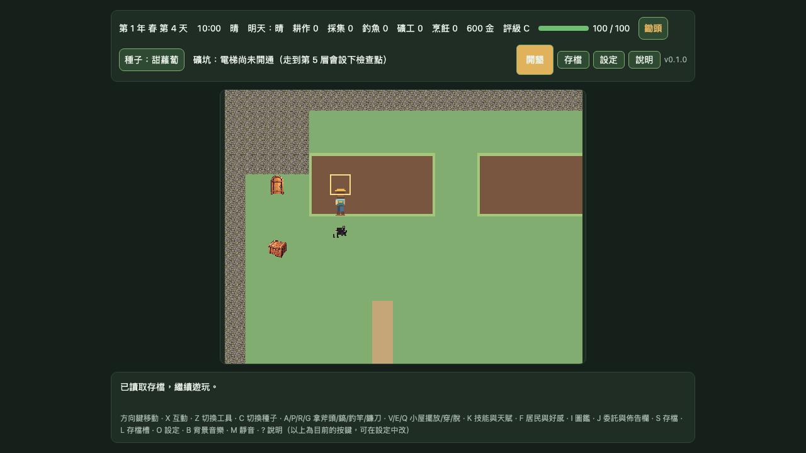

# DF-G1-PET-FOLLOW｜pixel32 候選貓咪跟隨動畫

## 結果

在 farm `MapScene` 的精確 DEV-only opt-in 下，候選黑貓沿用既有 follower root、目標格、110 ms 移動與腳底深度排序，依未核准 atlas 播放四方向 `hop-a → hop-b → land → idle`。Playwright 逐影格觀測到四方向完整序列；貓咪仍在候選狀態。

啟用 query：

```text
?renderProfile=pixel32&gate1Runtime=pixel32-map-animation&gate1AssetPreview=pixel32-candidates&gate1CandidatePetFollow=pixel32-cat-follow
```

移除最後的 `gate1CandidatePetFollow` 後，候選寵物視覺維持停用，正式 cat rig 繼續呈現。

## 場景截圖

畫面為 Chromium 1280×720、DPR 1。每張圖記錄一次方向移動後候選貓咪已回到 idle 的 farm 場景；逐影格實測序列、格位、sprite 範圍及圖檔雜湊列於 [`evidence.json`](./gate1-mapscene-pixel32-pet-follow/evidence.json)。








## 素材與程式證據

- Pet manifest：SHA-256 `bc1cbc0d39091702d58867513fd029168b57bc348e3e21a80a50c90745de86ea`，`status: candidate`、`approved: false`。
- Pet atlas：SHA-256 `720411831a56879143ff3f6dd6877b0f2138744c1e81e9aff9c669c259e442f3`。
- 每格原生 32×32，腳底錨點 `(16, 28)`，顯示尺寸 64×64；每段動畫 130 ms，共 390 ms 後回到該方向 idle。
- 四方向各移動一次，跟隨者抵達玩家剛離開的格子；記錄到的序列分別為 `cat-up-*`、`cat-right-*`、`cat-down-*`、`cat-left-*`。
- 候選 manifest／atlas 請求成功；失敗請求、HTTP 錯誤與 page error 均為 0。精確隔離 query 缺失時，專項 E2E 的 fallback assertion 通過。
- 專項 Playwright：2/2 通過；完整 Chromium E2E：237/237 通過（9 workers，3.9 分鐘）。
- `npm run check` 通過：6 組素材檢查、TypeScript、162 個單元測試檔（1,640 passed／1 skipped）、production build 與 8 MB 預算；production payload 2.805 MB。

## 驗收界線

這是候選 cat 的 DEV 預覽，不會改動 quokka、正式 `CharacterRig` 素材、`content/assets.json`、正式 `public/`、移動規則或存檔。截圖與自動化訊號不代表逐像素美術評分、正式整合核准或 Gate 1 完成；仍缺 pixel16 同場景比較、60／120 fps 效能資料、像素品質人工審查及 iOS／Android 實機驗收（`DEVICE_PENDING`）。
