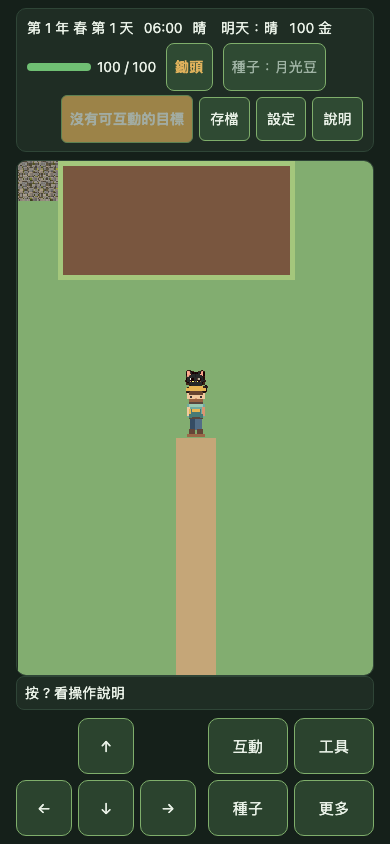
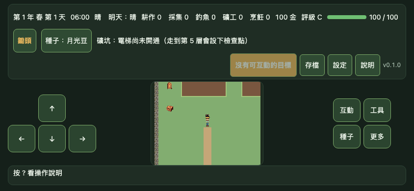
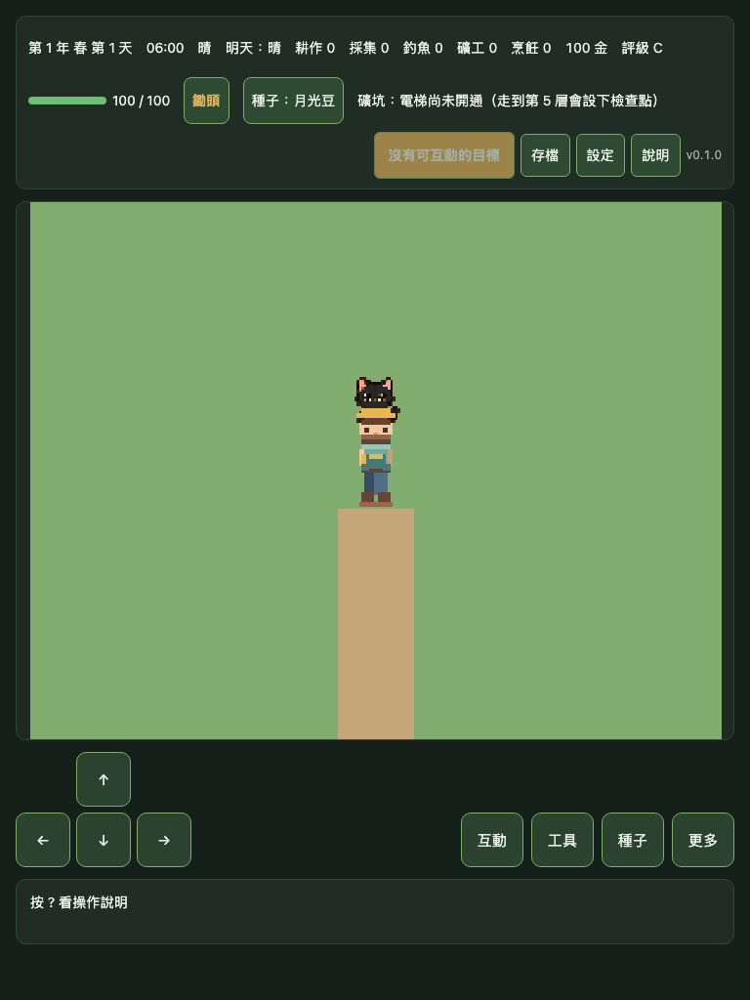
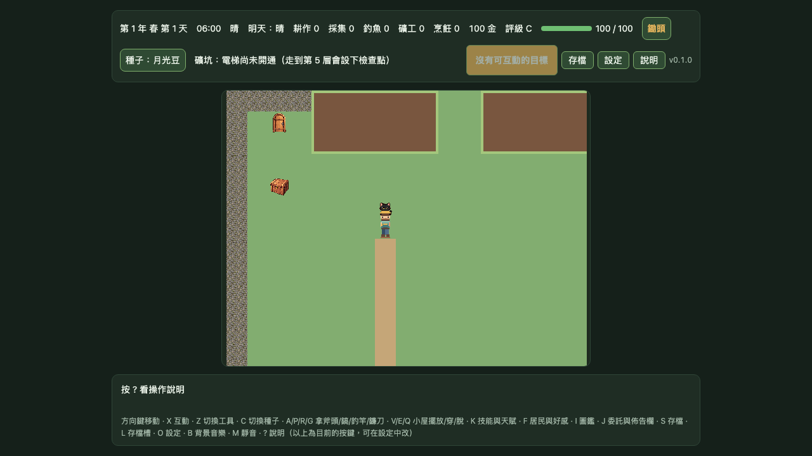
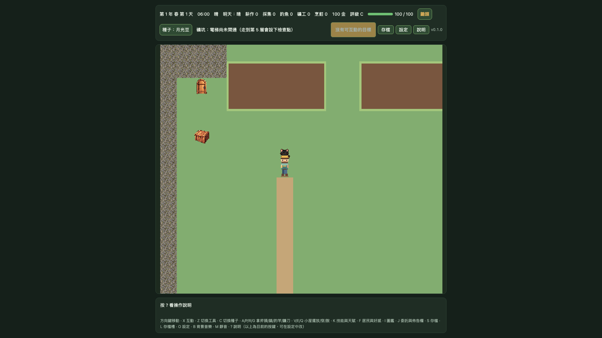

# Pixel32 候選 MapScene viewport／DPR 證據

> **狀態：15 組 Chromium 模擬擷取完成；候選素材未核准，Gate 1 未通過。** 這是同一個 DEV-only farm `MapScene` 在五種 viewport、DPR 1／2／3 下的候選 runtime 證據。

## 範圍與素材版本

- 使用明確 opt-in：`?renderProfile=pixel32&gate1Runtime=pixel32-map-animation`。
- 同一個 farm 起始狀態、同一份 `MapScene` 與同一組候選圖集；Playwright 對首次隨機值固定為 0。
- 只替換已覆蓋的地面（草地、田地、道路、水面）和玩家四向動畫。房屋、樹、土壤、作物、NPC、夥伴及工具仍使用舊素材。
- map manifest、animation manifest、map atlas、animation atlas 的 SHA-256 記在 [`matrix.json`](gate1-mapscene-pixel32-runtime/matrix.json)，每張截圖也有 SHA-256。
- Playwright 截圖使用 CSS 尺寸輸出；DPR 是 Chromium context 設定並單獨記錄，可檢視該 context 下的 viewport／遊戲版面行為，但**不是 DPR 專屬 raster／實際螢幕像素驗證**。這些截圖只證明桌面 Chromium 模擬，不代表 iOS／Android 實機、人工美術核准或 Gate 1 通過。

## 代表畫面

| Viewport | Canvas render resolution | 可見遊戲格 | DPR 2 截圖 |
|---|---:|---:|---|
| 手機直式 390×844 | 288×416 | 9×13 |  |
| 手機橫式 844×390 | 448×352 | 14×11 |  |
| 平板直式 768×1024 | 288×224 | 9×7 |  |
| 桌面 1280×720 | 544×416 | 17×13 |  |
| 桌面 Full HD 1920×1080 | 544×480 | 17×15 |  |

每種 viewport 另有 DPR 1 與 3 的截圖，完整 15 張與量測資料可在 [`screenshots/`](gate1-mapscene-pixel32-runtime/screenshots/) 和矩陣 JSON 查閱。由於輸出為 CSS 尺寸，同一 viewport 在不同 DPR 下的 PNG bytes 可能相同；這不是高 DPI raster 覆蓋證據。矩陣中的 SHA-256 識別目前存檔的確切 PNG 與候選輸入版本，不保證不同 Chromium／作業系統或重新擷取時逐位元相同。

## 驗證與重現

E2E 在每個 viewport／DPR context 逐一確認：

- farm map 已啟動且 pixel32 DEV-only runtime 已明確啟用。
- map／animation frame 清單已載入，玩家停在 `down-idle`。
- Canvas CSS 尺寸、backbuffer／render resolution、可見格數、camera zoom 和 browser DPR 診斷有效；不把 CSS-scale PNG 解讀成 DPR raster 驗收。
- 兩份候選 manifest 在執行前仍為 `candidate`、`approved: false`。

```bash
SAVE_GATE1_PIXEL32_RUNTIME_EVIDENCE=1 \
E2E_BASE_URL=http://127.0.0.1:5183 \
PWA_BASE_URL=http://127.0.0.1:4174 \
npm run test:e2e -- tests/e2e/gate1-mapscene-pixel32-candidate-evidence.spec.ts --workers=1
```

未設定保存旗標時，測試會把 PNG 與 JSON 附加至 Playwright 結果，但不寫入此證據目錄。

## 尚未驗收

- 完整固定 12×10 場景的物件覆蓋與候選 A/B。
- 每方向連續移動 5 秒、碰撞／不穿越、樹與建築遮擋、農作物與夥伴行為。
- 100% 顯示下的輪廓／腳底錨點／接縫／閃爍人工評分與候選素材逐項核准。
- 原生 iOS／Android 安全區、觸控、效能及像素穩定性，仍為 **`DEVICE_PENDING`**。

候選進入本階段只核准擴充測試證據，不核准任何特定圖檔或正式整合。依 [素材審核流程](../../asset-review.md)，每個確切素材版本仍須另行明確核准。
