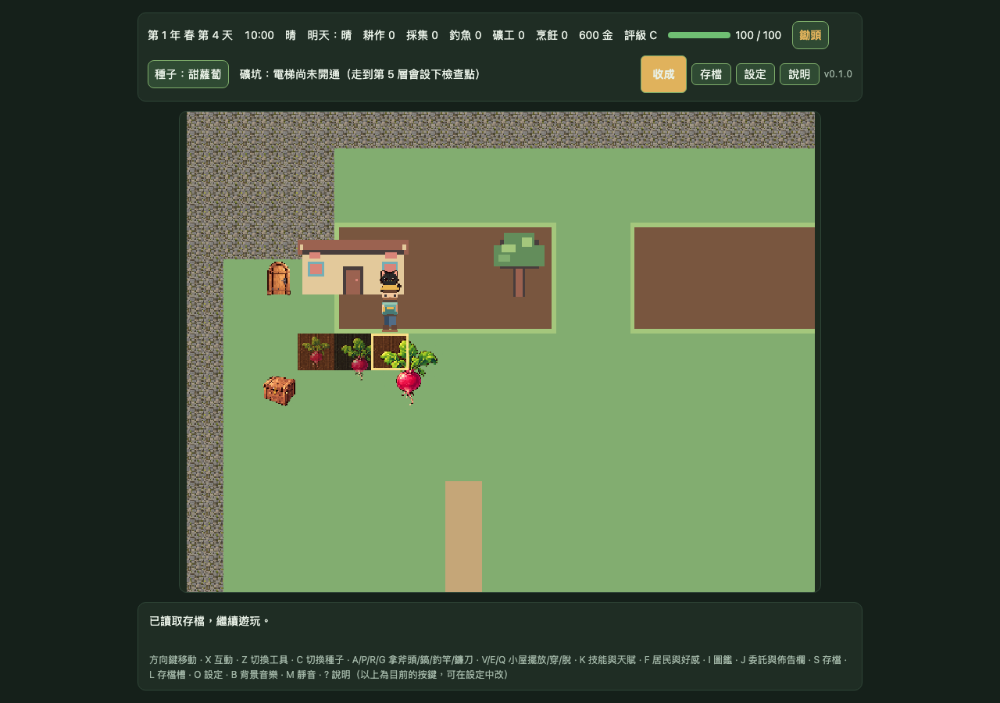

# DF-G1-SCENE-COMPOSITION-12X10｜pixel32 候選場景構圖

> **狀態：DEV-only Chromium runtime 證據完成；素材仍未核准，Gate 1 未通過。** 本報告記錄一個固定存檔與 viewport 下的候選場景，供後續審查；不代表完整素材覆蓋、原生裝置驗收或正式素材整合。

## 預覽

完整 camera 視野為 17×13 世界格，包含至少 12×10 的場景區域。上方狀態 HUD 和下方操作說明仍屬正式 UI；世界畫面使用精確 DEV-only pixel32 runtime／overlay opt-in。

## 候選與覆蓋

- 地圖 atlas 提供草地、田地邊緣、道路與房屋底層；玩家使用 pixel32 四方向候選動畫。`house-back`、`tree-canopy`、`house-front` 三個候選 overlay 均載入並保持顯示。
- 三階甜蘿蔔、夥伴貓、NPC、工具及未覆蓋地物都使用既有素材 fallback；fallback 清單與代表 crop bounds 收錄於 [evidence.json](./gate1-mapscene-pixel32-scene-composition-12x10/evidence.json)。
- 候選輸入 SHA-256：map manifest `3a179659310f657b70bfd5a929e671d8fbce340e241fe16fbb90bb5d5b27c9ea`、map atlas `64418c1bb8099a821ff32fd520bf3680e7416b4d99e8a50f84f1da05125a2184`、animation manifest `ebeb2be797d5e6b16d643aeb8a2e7d8b090fc427099d892957b94f2f626692f8`、animation atlas `15ad5e872025c19baf5337cb3e08567d4665fdaba2ee68126bf07d8b893c00a3`。
- Map 與 animation manifests 都維持 `status: candidate`、`approved: false`。

## 驗證與限制

- 專項 Playwright Chromium E2E：1/1 通過；1280×900、DPR 1；camera 視野 17×13 世界格。
- 候選 atlas／manifest 請求共 8 次；request failures、HTTP failures 和 page errors 均為 0。
- 截圖 SHA-256：`57235f5641699e0defe1fe6a990a93abe42cf84bdc754e6b0beeeb8990c27ff2`。
- 截圖為 Chromium CSS-scale 輸出，不是原生 DPR raster、iOS／Android 裝置或效能證據。
- 本 fixture 只用於隔離測試；不會更新使用者存檔。候選畫面仍缺完整 crops／companions／tools／NPC 素材覆蓋，亦未完成 10 情境可讀性、接縫／閃爍及腳錨人工評分。
- 此工作不改正式地圖、碰撞、gameplay、存檔 schema、`content/assets.json`、正式 `public/` 或候選核准狀態。原生裝置維持 `DEVICE_PENDING`。
