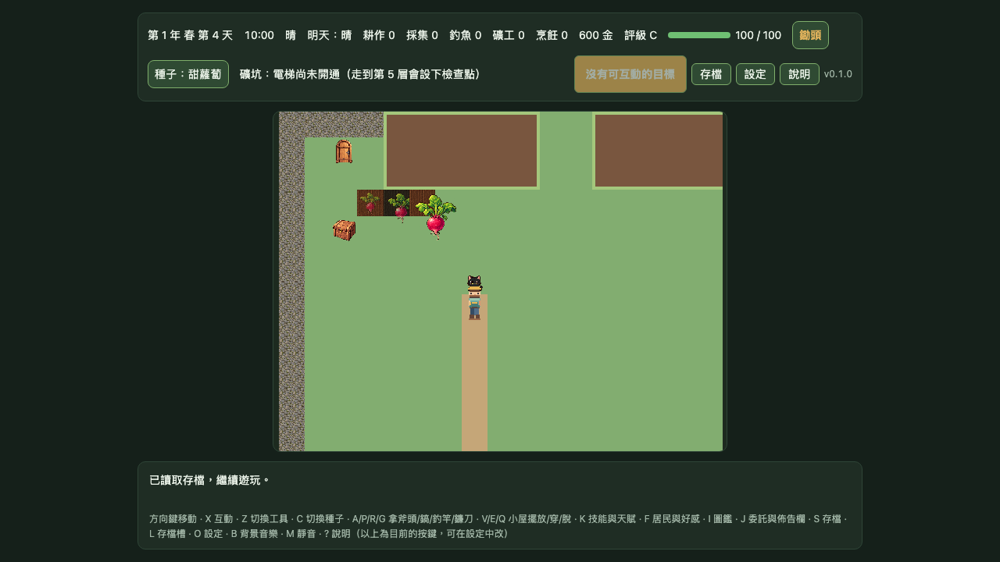
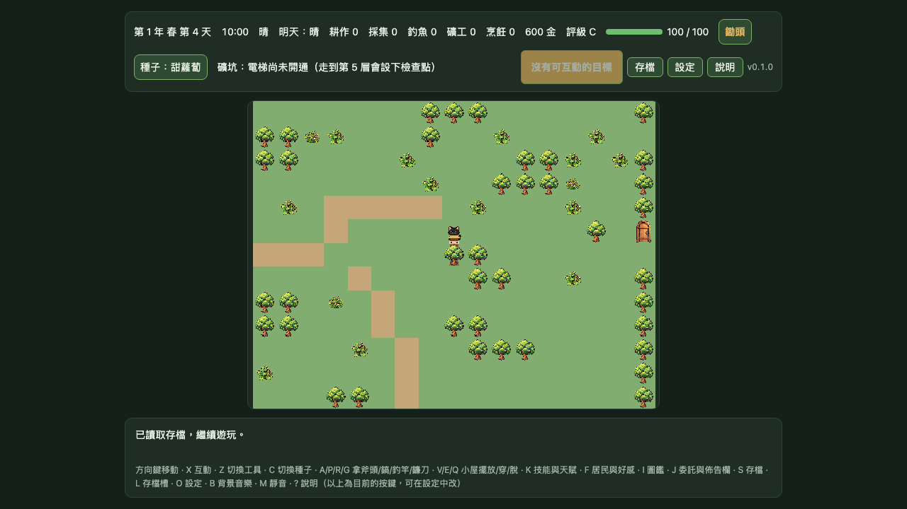

# Gate 1｜pixel32 MapScene 場景覆蓋證據

> **狀態：DEV-only Chromium 組合證據完成；Gate 1 未通過。** pixel32 地面與玩家仍為候選；本測試未核准任何確切素材，也沒有把既有 fallback 素材視為 pixel32 覆蓋。

## 測試範圍

使用精確開發路徑 `?renderProfile=pixel32&gate1Runtime=pixel32-map-animation`，在 1280×720 CSS px、DPR 1 的隔離 Chromium context 驗證兩個既有場景。測試以 v13 歷史格式 fixture 寫入隔離的 IndexedDB，確認遊戲遷移後載入；此舉沒有改動正式存檔格式或玩家存檔資料：

- Farm：候選地面與玩家同場；以確定性存檔檢查甜蘿蔔種子、幼苗、成熟三階仍使用既有正式圖檔，並確認黑貓跟隨玩家剛離開的格子且深度較低。
- Forest：以同一候選玩家檢查既有樹圖。玩家站在樹所在格時樹圖深度較高；移至樹南側相鄰格且外框重疊時，玩家深度較高。

這是既有地圖區域的驗證，不是固定 12×10 完整候選場景。樹、作物和貓都仍使用既有素材；pixel32 地圖 atlas 的 `tree-canopy`、`house-back` 和 `house-front` frame 尚未接入此 runtime。

## 結果

- Farm 實際繪製候選地面 frame：`spring-grass`、`spring-path` 與田地邊緣遮罩 `spring-field-edge-*`。
- 玩家候選動畫實際顯示 `down-idle`；候選檢查器確認黑貓 `pet.cat` 使用既有正式素材 fallback。
- 三階作物都使用 `crop.sweet-radish` 的正式 texture，顯示寬度依生長階段為 64、85、128 px。
- 玩家從 `(7,9)` 走到 `(7,10)` 後，黑貓由 `(7,8)` 跟至 `(7,9)`；深度分別為 21.001 與 20。
- Forest 的 `(15,7)` 樹與玩家外框重疊。玩家在樹格時深度 18.001、樹深度 18.002；玩家在 `(15,8)` 時深度 19.001、樹深度仍為 18.002。
- 專項 Playwright E2E：1 passed；完整 `npm run check` 通過（159 個單元測試檔、1,614 passed／1 skipped，build 與 8 MB 預算通過）；完整 Chromium E2E 229 passed。
- 證據截圖和量測雜湊見 [`evidence.json`](./gate1-mapscene-pixel32-scene-coverage/evidence.json)。

## 畫面





## 重現

```bash
SAVE_GATE1_PIXEL32_SCENE_EVIDENCE=1 \
E2E_BASE_URL=http://127.0.0.1:5200 \
PWA_BASE_URL=http://127.0.0.1:4200 \
npm run test:e2e -- tests/e2e/gate1-mapscene-pixel32-scene-coverage.spec.ts --workers=1
```

## 尚待完成

- 將 pixel32 `tree-canopy` 和多格建物前後層作為隔離候選接入 MapScene，驗證遮擋；不得改地圖碰撞或正式素材清單。
- 完成固定 12×10 組合場景及其候選覆蓋檢視。
- 候選角色、樹冠、建築和作物的確切版本仍需人工審查；原生 iOS／Android 驗收維持 `DEVICE_PENDING`。
- 本報告不宣稱正式素材整合、Gate 1 通過或原生裝置驗收。
