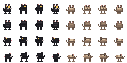

# Pixel32 黑貓與矮袋鼠候選

**狀態：`candidate`／`approved: false`。** 這是隔離的原創寵物像素稿，尚未取得使用者對新圖、方向或動畫的核准，也沒有接入遊戲 runtime。

## 預覽

啟動 `npm run dev`，再開啟 `http://localhost:5173/docs/art/candidates/pixel-movement/gate1-pets-pixel32/preview.html`，可切換物種、朝向與姿勢。圖集以 2× 最近鄰顯示；請以 100% 放大像素畫面，再參照下方 checklist 檢查。輸出圖集為 [`pets-pixel32.png`](./pets-pixel32.png)，逐幀座標、錨點、SHA-256 和來源在 [`manifest.json`](./manifest.json)。



## 素材與契約

- `cat` 是四足黑色家貓；正面有尖耳、短口鼻、鬍鬚和金色眼睛，側面可見尾巴。
- `quokka` 是棕灰色、低伏緊實的四足有袋動物，使用寬短口鼻、小圓耳、較有力後軀和自然尾巴來區別貓與小熊輪廓。
- 每種動物提供下、上、左、右四方向；每方向含 `idle`、`hop-a`、`hop-b`、`land` 四格。每格原生 `32 × 32` RGBA、錨點／pivot `(16,28)`，用最近鄰 2× 放大。
- 已核准靜態黑貓與矮袋鼠 PNG 僅供辨認物種特徵；不沿用其核准到本圖集任何像素、朝向、動作或尺寸。
- 素材由整數像素圖元手工編碼生成；未使用第三方遊戲素材、使用者提供的網路遊戲畫面或圖生圖輸入。

## 候選目視 checklist

- [ ] 黑貓所有朝向皆可辨認為自然四足黑貓；金眼、貓耳、短口鼻、鬍鬚輪廓清楚，長尾比例符合角色 brief。
- [ ] 矮袋鼠所有朝向皆可辨認為 quokka；棕灰短毛、寬短口鼻、小圓耳、低伏軀幹、發達後肢和自然尾巴清楚。
- [ ] 兩種動物均沒有直立人形軀幹、手指、衣物、配件或人獸混合特徵；矮袋鼠不呈小熊式輪廓。
- [ ] 四方向身份、動作連續性、四足接地、透明邊緣及 64×64 遊戲世界顯示尺寸清楚。
- [ ] 記錄每個需核准版本的 atlas SHA-256、逐幀 SHA、預覽、例外與明確決定。

既有靜態圖的核准邊界和物種細節以 [`docs/art/pet-anatomy-checklist.md`](../../../pet-anatomy-checklist.md)、[`docs/art/character-briefs.md`](../../../character-briefs.md) 與 [`docs/art/asset-review.md`](../../../asset-review.md) 為準。每個確切新版本仍須獨立審查；不可修改 `public/`、`content/assets.json`、`content/rigs.json` 或夥伴 runtime 來繞過素材審核。

## 重現與檢查

```bash
node tools/art/generate_gate1_pets_pixel32.mjs
node tools/art/check_gate1_pets_pixel32.mjs
npx vitest run tools/art/check_gate1_pets_pixel32.spec.ts
```

checker 驗證固定雙物種與 32 幀、候選狀態、32×32 RGBA 像素規格、anchor/pivot、atlas/逐幀雜湊和綁定 generator 的逐位元重現。checker 無法判斷物種是否真的可辨認、動作是否自然或畫面是否通過人工美術／裝置審查。
