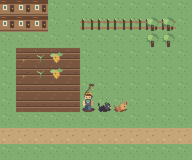
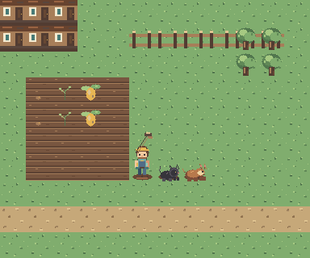

# Gate 1 原生像素候選預覽證據

> **狀態：候選美術樣張，未核准。** 本頁記錄一個可重現的靜態預覽切片；它不是遊戲內 A/B、動作或實機驗收，也不代表 Gate 1 通過。

## 預覽結果

預覽頁：[`index.html`](index.html)。啟動 Vite 開發伺服器後開啟 `/docs/art/candidates/pixel-movement/gate1-preview/`。

兩套候選以相同的固定 12×10 合成配置繪出，CSS 圖塊顯示尺寸皆為 32px：A 將原生 16×16 網格以最近鄰放大 2 倍，B 使用原生 32×32 網格。候選 atlas 以逐像素整數圖元建立，沒有重採樣舊素材。現況按鈕載入既有 390×844 遊戲截圖作參考；現況截圖與 A/B 樣張不是同一場景，不能視為受控的三方畫面比較。

## 檔案完整性

| 檔案 | 尺寸 | SHA-256 |
|---|---:|---|
| [`8bit.png`](../gate1-assets/8bit.png) | 64×96 atlas；16×16 tile | `c577db439d5b485af70cf1c5e6bd18d9507b3e8ac378bcedd5971b578ae89975` |
| [`16bit.png`](../gate1-assets/16bit.png) | 128×192 atlas；32×32 tile | `26999d1a77433112b5f2e6993ce69ac774aef9a41cb6f7c90cadf17bca9d584b` |
| [`candidate-8bit.png`](candidate-8bit.png) | 384×320 preview | `11f46a1283c867f92a0e6b8cea829823ac9cee7e9aad67c4439c5cfe940b72f3` |
| [`candidate-16bit.png`](candidate-16bit.png) | 384×320 preview | `94dbec336d4ce268039043283626d84c039f879638c645add71ef1b8cc3c31b0` |

## 自動驗收

- `npm run check`：**通過**，153 個單元測試檔／1,577 項通過、1 項略過；production build 與 8 MB 預算檢查通過（2.791 MB）。
- 完整 `E2E_BASE_URL=http://127.0.0.1:5193 PWA_BASE_URL=http://127.0.0.1:4193 NO_PROXY=127.0.0.1,localhost no_proxy=127.0.0.1,localhost npm run test:e2e -- --workers=2`：Chromium **209/209 通過**，10.3 分鐘。
- 最終補強後候選專項 `E2E_BASE_URL=http://127.0.0.1:5193 PWA_BASE_URL=http://127.0.0.1:4193 NO_PROXY=127.0.0.1,localhost no_proxy=127.0.0.1,localhost npm run test:e2e -- tests/e2e/gate1-candidate-preview.spec.ts`：Chromium **1/1 通過**，5.3 秒。
- E2E 驗證 manifest／atlas 可讀、A/B 維持 `candidate` 且 `approved: false`、15 個 frame key 和原生尺寸、PNG 簽章／尺寸／SHA-256、每格 frame 邊界與腳點錨點、12×10 場景畫布尺寸、非空像素內容、384×320 截圖尺寸、legacy 截圖切換與 2× 顯示比例。
- 截圖矩陣 viewport/DPR、連續移動影片與實機顯示不在這個測試內。

## Gate 1 尚未完成

- 角色目前只有向下 idle／單一 walk 姿勢，沒有四方向 idle/walk 完整影格；寵物也只有單幀。
- 預覽使用靜態合成座標，沒有載入遊戲地圖／存檔，也沒有接入 `MapScene`、碰撞或正式 `CharacterRig`。
- 尚未產生 Gate 1 要求的 5 種 viewport × DPR 1/2/3 遊戲矩陣與 10 格移動、反向、急轉、斜向、農務、遮擋和寵物跟隨影片。
- 尚未完成人眼的 100% CSS 尺寸辨識與地面接縫審查、真實手機輸入延遲及效能測試。

兩套素材與風格都等待使用者明確選定；本次「核可」只授權接續本階段隔離候選證據，不構成美術方向選擇或正式素材整合批准。
