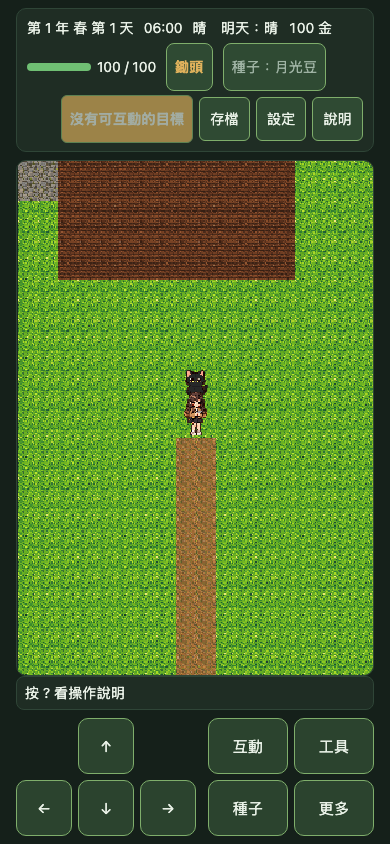

# Gate 1｜遊戲執行畫面與操作證據補充

> **狀態：桌面 Chromium 證據完成；Gate 1 未通過。** 本報告補足既有 render profile 的解析度／視野矩陣與一段可重現的 farm 操作流程，供後續人工比較使用。

## 範圍與解讀

- 45 張畫面來自同一個新遊戲 farm 起始狀態、同一個 `MapScene` runtime 與同一份既有遊戲素材，涵蓋 `legacy`、`pixel32`、`pixel16` × 五種 viewport × DPR 1/2/3。
- `pixel32`、`pixel16` 只改變遊戲內部 render resolution 與 camera FOV。**目前三種 profile 都仍使用舊遊戲素材**；截圖不能當作 8-bit／16-bit 原生素材的遊戲內 A/B，也不構成風格選擇或素材核准。
- viewport 依既有 responsive 規則調整可見格數；「12×10」沿用候選靜態預覽的固定組合區定義，不強制不同螢幕在同一畫幅顯示完整 12×10 格。
- 所有畫面均由 Playwright Chromium 模擬產生，截圖以 CSS 像素輸出。DPR 數值、canvas CSS 矩形、內部 render resolution、可見格數、camera zoom 與 PNG SHA-256 收錄在 [`matrix.json`](gate1-runtime-evidence/matrix.json)。45 張圖均已核對檔案與 SHA-256 一致。

## 代表畫面

390×844 CSS px、DPR 2；以下 profile 的遊戲素材相同，畫幅／相機策略不同。

| Profile | 畫面 |
|---|---|
| `legacy` |  |
| `pixel32` |  |
| `pixel16` |  |

其餘 viewport／DPR 的 42 張截圖在 [`gate1-runtime-evidence/screenshots/`](gate1-runtime-evidence/screenshots/)；逐筆解析度與雜湊見矩陣 JSON。

## 移動與農務錄影

每段影片都是 390×844 CSS px、DPR 2 的 Chromium Playwright 錄影，25 fps；同一組輸入序列從 farm `(7,9)` 開始。

- [`legacy：移動與耕地`](gate1-runtime-evidence/videos/legacy-movement-and-farming.webm)
- [`pixel32：移動與耕地`](gate1-runtime-evidence/videos/pixel32-movement-and-farming.webm)
- [`pixel16：移動與耕地`](gate1-runtime-evidence/videos/pixel16-movement-and-farming.webm)
- [`輸入時間軸與角色格座標`](gate1-runtime-evidence/videos/movement-and-farming.json)

三種 profile 都記錄到：按住右移正好到 `(17,9)`、按住左移返回 `(7,9)`；黑貓由 `(7,8)` 跟至 `(16,9)`；上、右、下、左轉向序列回到起點。接著同時按上與右 450ms，三者都經現有四向格狀輸入逐格移動、沒有斜向格移動；實際終點依序為 legacy `(8,7)`、pixel32 `(8,6)`、pixel16 `(8,6)`，完整輸入時間軸見 JSON。之後玩家走到 `(7,5)` 面向上方並耕作前方地格 `(7,4)`，體力由 `100` 降至 `98`。

## 可重現方式

```bash
SAVE_GATE1_EVIDENCE=1 \
E2E_BASE_URL=http://127.0.0.1:5183 \
PWA_BASE_URL=http://127.0.0.1:4173 \
npm run test:e2e -- tests/e2e/gate1-runtime-evidence.spec.ts --workers=1
```

不設定 `SAVE_GATE1_EVIDENCE=1` 時，測試仍會驗證矩陣與錄影並附加到 Playwright 結果，但不寫入本目錄。每個 browser context 隔離存檔；初始首次隨機值固定，確保 farm 起始狀態可重現。

## 尚待完成的 Gate 1 項目

- 候選 `8bit.png`／`16bit.png` 尚未接到同一遊戲 runtime；本組畫面沒有用新 atlas 取代地形、玩家、作物或寵物。
- 沒有矮袋鼠、樹／建築移動遮擋、斜向輸入壓力循環、每方向連續 5 秒與 60/120 fps frame-time 證據；影片 fps 為 25，不作為這些條件的驗收。
- 未完成 100% 畫面尺寸下的 10 情境辨識率與地面接縫人工評分；代表畫面僅做截圖完整性 spot-check。
- 原生 iOS／Android 安全區、觸控、效能與實機像素抖動仍為 **`DEVICE_PENDING`**。
- 8-bit、16-bit 與 legacy 方向仍待使用者依同 runtime 候選證據選擇。此報告不替使用者核准風格，也不批准正式素材整合。
