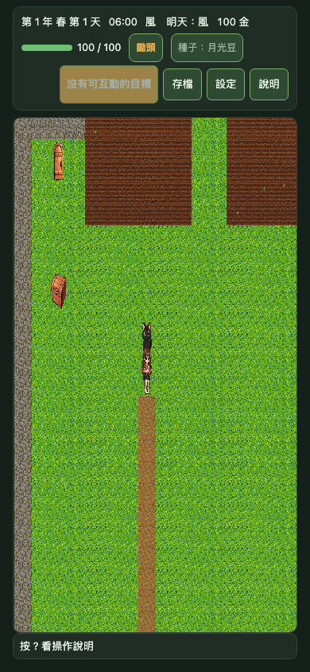
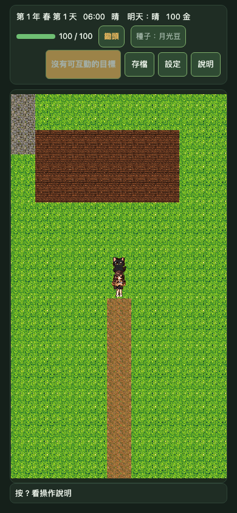
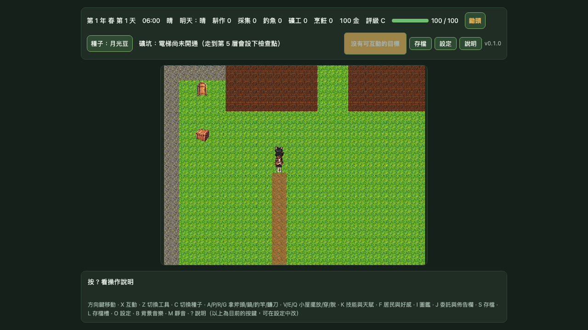

# PROT-01 移動與鏡頭原型證據

> 本報告是 Chromium 桌面測試環境的原型記錄。截圖以相同的 farm 起始狀態、頁面尺寸和遊戲版本擷取；不是實機測試，也不是 8-bit／16-bit 素材驗收或美術風格核准。

## 實際遊戲畫面

| QA profile | 手機直式 390×844 CSS px | 桌機 1280×720 CSS px |
|---|---|---|
| legacy |  |  |
| pixel32 |  |  |
| pixel16 |  |  |

截圖由 `tests/e2e/.capture-pixel-profile.spec.ts` 的單次輔助流程擷取，臨時測試檔已移除。正式 E2E 保留 profile 可選性、viewport/DPR 矩陣和移動驗收。

## 實際渲染結果與限制

- `legacy` 保持既有 1024×768 畫布與生產鏡頭。390×844 下 pixel32/pixel16 實測為 288×512 與 144×256，視野皆為 9×16 格；1280×720 下為 544×416 與 272×208，視野皆為 17×13 格。QA profile 依政策目標格數調整 Phaser 畫布的實際內部解析度，並讓 camera viewport 使用同一尺寸；world tile 座標與遊戲狀態不變。
- `pixel32` 的內部畫布以每格 32 像素輸出；`pixel16` 以每格 16 像素輸出。直式手機與桌機採各自 viewport 的可視格數與畫布長寬比，因此 camera 實際可視格數與政策目標一致。
- 六張畫面是同一組現有遊戲素材在不同內部解析度下的真實遊戲截圖，可比較畫面密度與鏡頭視野。它們不是 32×32／16×16 原生製作的新素材，也不代表已核准像素美術風格；目前地面、角色與物件仍由既有素材縮小繪製。
- profile 只允許開發模式的 QA query 啟用；正式預設仍是 legacy。`ScaleManager.setGameSize()` 依 Phaser 官方 API 調整 FIT 模式的基準尺寸；候選畫布在既有 CSS stage 以 `object-fit: contain` 等比呈現，legacy 保留原顯示方式（[Phaser Scale Manager](https://docs.phaser.io/phaser/concepts/scale-manager)）。
- 另一組 8-bit／16-bit 概念圖位於 [`README.zh-TW.md`](README.zh-TW.md) 所列路徑。那是生成的靜態風格概念，不是上述遊戲截圖，也尚未轉成可玩素材。

## 移動與相容性驗收

- 按住方向鍵 520ms 能跨越至少兩格；放開後輸入狀態清除，等待期間位置不再變動。
- 單一步驟進行中只保留最新一個離散輸入方向；鍵盤和 D-pad 短按走相同緩衝路徑。blur、面板、地圖切換與 pointer 取消均清除 held/queued input。
- 使用 5 種 viewport（390×844、844×390、768×1024、1280×720、1920×1080）與 DPR 1/2/3 執行 Chromium 診斷矩陣，並比對實際 canvas 尺寸；另外跑完整 E2E、單元、建置及模擬驗收。
- 測試不代表真實手機的 50 FPS、實體觸控延遲、100% 顯示辨識度或移動影片驗收；這些仍需實機與人工審閱。

## Gate 狀態

- PROT-01 交付：實際 profile 畫布解析度管線、viewport 相符的 camera、輸入／移動原型、同尺寸遊戲截圖與自動化驗收。
- 尚未完成：32×32／16×16 原生遊戲素材、連續 10 格錄影與實機辨識度／效能測試。
- 8-bit／16-bit 風格及正式素材均未核准。後續 ART-02／ANIM-01 等工作須待使用者審閱候選後再開始。
