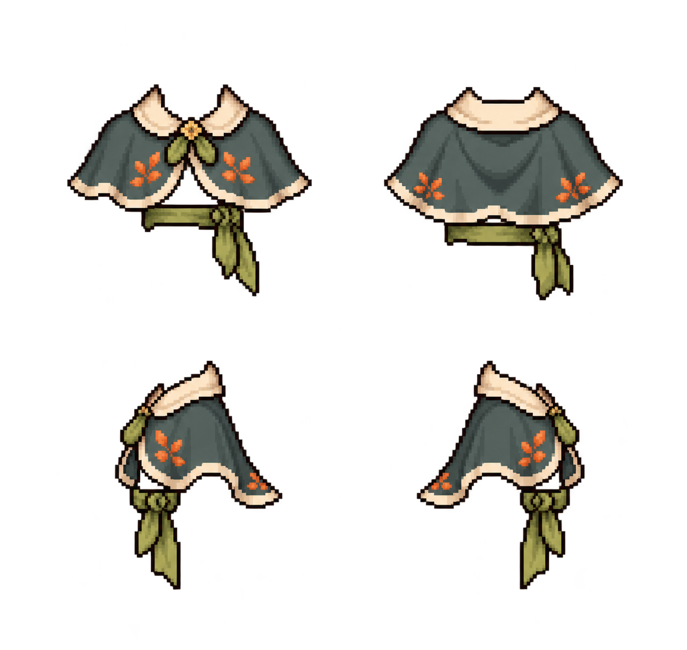

# VF-16 玩家森林旅行披肩候選

> **狀態：candidate；未經使用者核准，禁止進入 `public/` 或 `content/assets.json`。** 本候選只供美術方向與 rig 接合可行性檢視，沒有實作四向 runtime 換裝。

## 候選與來源

| 項目 | 證據 |
|---|---|
| 檔案 | `forest-traveler-cape-candidate-20261027.png` |
| SHA-256 | `0824412c54e1bc5529a9f86779ad7047117228649c900e308bbf75978fc725a2` |
| PNG | 1289 × 1221，RGBA，8-bit/channel，non-interlaced |
| Alpha | 完全透明 1,237,099；半透明 335,527；不透明 1,243；任意非零 alpha bbox `(0,23,1273,1221)`（右／下界不包含） |
| 產生方式 | Codex 內建 imagegen 生成一張四向 2×2 服飾概念圖，再以內建 imagegen 修整為布料層；已生成的最終 PNG 原始位元組複製至此，未裁切、縮放或重繪 |
| 參考圖 | `public/assets/characters/xiaohan-2x.png` SHA `e7f19903932679bdc378d70fab1cc407e0c2a03ad557623f8e7bbfd3d85e1`；`xiaohan-back-2x.png` SHA `7957c0064392269cc4edfbb8ffd1f470bff6c1ae71a10ba929f9eaaa7976b300`；`xiaohan-side-2x.png` SHA `067293dbe2d12d7ec1f620f7c5b073ddd9971afd3138d782ce8d7ec94f3909a8` |
| 參考用途 | 只作小涵原創角色的外形、方向及置中比例參考；未擷取或描摹參考圖像素。右向依專案 rig 慣例以左向鏡射為目標 |
| 來源／權利限制 | 工具未提供可查證的模型名稱或授權條款；本紀錄不推定模型或授權。生成來源與權利仍須由素材審核確認 |

候選主題是藍綠短披肩、奶油色領邊、葉綠腰帶及鏽橘刺繡。它是視覺提案，不代表一個已存在的道具、服飾品項、正式四格 spritesheet 或角色換裝功能。

## Rig 與衣物規則檢視

- `content/rigs.json` 的 player rig 是 128 × 160 母版，`legTop=130`，down/up/left 的 splits 為 60/60/62；right 沒有獨立圖，由 left 水平鏡射。`CharacterRig` 以格底中心作 root，角色來源圖的腳底對齊該位置。rig 沒有服飾 layer、服飾錨點或 overlay frame 定義。
- 現行三方向 player 圖都是 128 × 160；可見 alpha bounds 分別為 down `(14,11)–(121,154)`、up `(27,11)–(105,153)`、left `(30,13)–(102,154)`。候選是 1289 × 1221 的整張概念板，面板邊界／每向 128 × 160 cell 沒有編碼，也沒有可驗證的腳底錨點；四方向不具逐格拆取、等比對齊的證據。任意縮放／裁切會產生新素材與 hash，且不能證明與手持平板、斜背包或腳部切層相容。
- Alpha 通道是真透明，不是棋盤格；但半透明像素占畫面約 21.3%，且任意非零 alpha 延伸到畫布邊緣。這代表仍需檢查低 alpha 毛邊／背景殘留，並不符合目前像素角色素材要求的乾淨硬邊驗收。
- 現有服飾資料只有可穿戴 `clothes` 與 `sun-hat`，沒有 `cape` 種別、服飾變體或穿搭層規則；`MapScene.syncWearing()` 目前只在頭上畫色塊。候選披肩不能以現況直接使用。若未來由使用者明確決定將披肩作為 `clothes` 的唯一外觀，仍須先建立 128 × 160 四方向分格與 layer/遮擋接合設計、產出新確切檔案/hash，再逐檔核准；帽子規則不適用。

## 審查結論

**REQUEST CHANGES（只適用本候選；不得標成 reviewed / approved / integrated）。** 色彩與披肩外輪廓在概念尺寸可辨識，但當前檔案缺少 cell 邊界及 rig 錨點，與既有方向圖的遮擋關係未驗證，alpha 邊緣也未達可直接整合條件。依任務限制保留原候選，不擅自改 rig、runtime、正式素材、manifest 或核准清單。下一個安全步驟是讓使用者先確認是否保留披肩／腰帶方向；確認後再製作貼合 128 × 160 三向角色母版的候選，right 仍依既有 left mirror 規則處理，最後為新檔重新計算 hash 並個別送審。
